# Angular Fourier and circle compression experiments

> **FAFT is defined in [FAFT.md](FAFT.md).** It is the exact, closed-form Fourier
> integral of the circle-determined curve at any real frequency, with its
> continuous relevant-peak search, measurements and limits. The sections below are
> earlier experiments, kept as controls with their published numbers. The
> hierarchical/adaptive and geometry-first sections compute a **sampled** DTFT of
> the circle curve, with `zoom` as a transform parameter. That only approaches the
> transform of the circles, as a zoom-z DTFT equals FAFT plus spectral images
> (measured in FAFT.md). The "FAFT" rotating-phasor section is an FFT-based
> optimizer, now the `phasor_fft` module.

The earlier hierarchical circle fitting and adaptive relevant-frequency retrieval
follow. They precede the dyadic geometry control, the FFT phasor control, the
integral reference preset, and the compression experiment.

## Hierarchical circles and adaptive relevant frequencies

Status: `GeometryFrame::hierarchical` is the circle determination feeding FAFT.
Its `GeometricSpectrum`/`AdaptiveSpectrum` spectra are the sampled (zoom)
control that [FAFT.md](FAFT.md) re-measures on the same windows.

This extension added **source-informed children, variable sample supports,
checked circle merging, and a variable list of relevant frequencies**. The older
DP geometry bank below remains an independent control. The pipeline is:

```text
original samples → try a parent waveform circle over a variable range
                 → failed parent: source-informed child fits
                 → adjacent children: refit + check a merged circle
                 → compiled, independently centered rotations
                 → arbitrary-frequency finite sums
                 → bounded relevance/depth/width search + nearby peak merging
```

[src/geometric_faft.rs](../src/geometric_faft.rs) implements
`GeometryFrame::hierarchical`, `HierarchyParams`/`HierarchyStats`, and prepared
`GeometricSpectrum` queries. [src/adaptive_faft.rs](../src/adaptive_faft.rs) owns
`FrequencyParams`, `AdaptiveSpectrum`, points, peaks, bands, uncertainties and
stop reasons. Neither module uses an FFT or a Fourier integral.

### Variable source ranges and child merging

The new hierarchy accepts any integer `max_span` in 2..256, including nonpowers
of two. It first tries a parent over a complete support, searching the existing
interior-point, aperture and precision bank. Three points define the candidate's
circle, while **every sample in its support** and its terminal anchor determine
whether that circle is acceptable. The support is not restricted to three
consecutive samples or one encoded bitrate. A circle can cover different numbers
of source samples and use its own geometry precision.

A failed parent splits at a large source deviation from its endpoint line, clipped
to the central half of the support. Children are fitted against original samples,
not synthesized parent points. At `max_depth` or `min_span`, checked source-pair
lines preserve coverage. No unresolved region silently becomes zero. Adjacent
children then compete with one refitted model over their combined support.
A merge is accepted only when its circle/line satisfies the same source and anchor
checks, including rounded parameters. Merge passes can cross earlier root/split
boundaries and are capped separately (0..16). Accepted merges remove one descriptor
each. Lines remain finite zero-curvature limits, without storing infinity.

This is a greedy split/refit preset, not a global optimum. The original dyadic DP
preset retains its own shortest-path contract. Children replace parent supports;
they are not additive residual oscillators. Final source maximum/RMS errors are
remeasured in original amplitude units. The model retains no original PCM.

### Inverting the projected rotations

A prepared angular half or line, on a support starting at s and containing L
grid samples, can be written as

\[
y_{s+j}=c+A\sin(\beta j)+B\cos(\beta j)+d j,
\qquad 0\leq j<L.
\]

For a circle starting at angle theta, `c=cy`, `A=r*cos(theta)`,
`B=r*sin(theta)`, and `d=0`. For a line, `A=B=0` and d is its finite slope.
Each circle's center belongs to its local scaled coordinates. Horizontal center
and aperture determine the fitting angles; time start s supplies the global
spectral phase. Two halves of one circle can have different beta. These local
angular rates are not automatically the source sound's physical frequencies.

Let `G(delta,L)=sum(exp(i*delta*j))` and
`H(delta,L)=sum(j*exp(i*delta*j))` over j=0..L-1. The inverse direction from the
retained projected geometry to its finite spectrum is

\[
Y_s(\omega)=e^{-i\omega s}\left[
cG(-\omega,L)
+\frac{A}{2i}\{G(\beta-\omega,L)-G(-\beta-\omega,L)\}
+\frac{B}{2}\{G(\beta-\omega,L)+G(-\beta-\omega,L)\}
+dH(-\omega,L)\right].
\]

Sum the independently centered supports with their phases. Centers do not need
to coincide: the constant term, support and phase already account for the shifts.
This retrieves the sampled predictor's spectrum without solving a matrix or
integrating arcs. Finite support matters: even a local constant has energy away
from DC. It is not a unique recovery of a physical additive rotating chain.

`value` keeps the stable closed-sum reference. The faster `value_rotations`
prepares each circle's `exp(±i*beta)` and `exp(±i*beta*L)` once. For each requested
frequency it computes a shared rotation root and updates support powers with
integer exponentiation, products and ratios. DC/resonance limits and near-DC line
moments use stable fallbacks; support phases reanchor every 64 pieces. Thus most
per-circle retrieval uses algorithmic arithmetic. New frequencies still require
one sin/cos pair for a rectangular query, three for periodic Hann, plus fallback
trigonometry. It is not a purely arithmetic transform or an asymptotic FFT claim.

Prepared queries use radians per **original** sample, including when zoomed.
Coefficients are normalized by the sampled grid length, or half that length for
periodic Hann. A unit real sine has approximately 0.5 coefficient magnitude.
Hann weights apply after fitting, so this benchmark differs from the preceding
survey that fitted already-windowed samples. Preparation computes amplitude and
centered first-moment bounds with O(N*zoom) work. Each finite-sum query is O(P)
for P retained angular/line pieces; Q arbitrary queries cost O(PQ).

### Continuous query frequencies, bounded search, and coarse precision

The finite-window DTFT is a function of arbitrary real frequency. The API returns
relevant peak locations instead of a fixed `N/2+1` output grid. An initial interval
cover seeds a strongest-first midpoint search, followed by bounded ternary
refinement of observed peak brackets. Midpoint/ternary updates use arithmetic
comparisons; the prepared circle oracle supplies complex spectral values.

`FrequencyParams` separates:

- Initial interval count and search range within the original Nyquist band.
- `max_depth` for interval subdivision and, separately, peak-refinement iterations.
- A hard combined coarse + fine `max_evaluations` budget (3..1,000,000).
- `min_width`, so indistinguishably nearby query frequencies stop refining.
- Absolute and relative relevance floors; the latter uses an observed peak lower
  bound, not a psychoacoustic audibility estimate.
- `merge_width`, which keeps the strongest nearby peak and counts suppressed
  candidates. Strongest-first merging avoids a transitive chain that could merge
  far-separated peaks.
- Optional sampled-quiet/flat pruning and its relative-gain threshold.

Every terminal band reports `BelowFloor`, `LowGain`, `Width`, `Depth`, or `Budget`,
with a predictor-magnitude upper bound. Below-floor pruning uses a centered
absolute first-moment bound: changing frequency by delta can change magnitude by
at most that moment times `abs(delta)`. The **LowGain rule is heuristic**: a quiet
or flat sampled interval can hide a narrow peak between probes. Depth/budget/width
stops and sampled peak brackets are explicit limitations, not completeness or
statistical confidence claims. Disabling heuristic pruning retains the limits.

An optional less precise circle model uses the same time range, sample grid,
zoom, and weights as the target. The measured weighted L1 difference between
those two predictors bounds their complex spectral difference at every frequency.
A coarse probe whose upper magnitude is below relevance can skip the fine query;
its uncertainty is retained. Preparation compares predicted grid samples, never
unknown source points. Zoom 1/2/4/8 tests sample the same fitted functions more
densely. A finer grid can compare model behavior but cannot supply more measured
information or guarantee unobserved intersample truth.

Arbitrary frequency-query precision is distinct from resolving close source
frequencies. FFT spectra can also be sampled more densely through zero padding;
this experiment compares that control directly. Frequency uncertainty still
depends on observation duration, noise, model error and any additional signal
assumptions. See the primary [SciPy spectral-analysis discussion](https://docs.scipy.org/doc/scipy/tutorial/signal.html#spectral-analysis)
for continuous spectra, window effects and FFT oversampling. No frequency
resolution independent of the recording's information is claimed here.

### Measured Beethoven hierarchy/adaptive benchmark

The [aggregate snapshot](experiments/adaptive-faft-beethoven-20260930.json) contains
21 measured windows: seven evenly spaced 1,024-sample raw mono PCM16 windows from
each two-second excerpt starting at 60, 180 and 300 seconds, at 44.1 kHz. Hierarchy
support is capped at 128; source peak tolerance is 16, minimum precision 12 bits,
with four merge passes. The coarse control uses tolerance 128 and minimum 8 bits.
Search seeds N/4 intervals, uses a 2% relevance floor, depth 12, 8,192 combined
oracle calls, minimum width 1/1,024 of a source FFT bin, and merge width half a bin.
Reported timing medians use three warmed in-process repetitions. Fitting,
preparation and queries are separate; audio decoding, text/JSON and plots are
excluded. Source FFT timing also excludes Hann preparation.

| Excerpt | Before merging | After merging | Dyadic DP control | Hierarchy fit | DP fit | Source peak error |
|---|---:|---:|---:|---:|---:|---:|
| 60 s | 188.14 | 139.00 | 127.57 | 1.375 ms | 10.639 ms | 15.967 |
| 180 s | 98.57 | 77.43 | 80.14 | 0.880 ms | 10.117 ms | 15.983 |
| 300 s | 419.86 | 287.43 | 273.14 | 2.822 ms | 9.754 ms | 15.982 |

The count columns are mean circle + line descriptors, not stored bytes. Merging
removes 26.1%, 21.4%, and 31.5% of the initial hierarchy descriptors respectively.
The hierarchy fits faster than the full DP bank; their searches and chosen models
differ. It beats the DP descriptor count only in the middle excerpt. Source RMS
errors average 7.33, 7.19, and 6.19 PCM16 units. No audio-quality or compression
ratio claim follows from these errors/counts.

| Excerpt | First retrieval attempt | Prepared-root retry | Fine-only retry | Mean relevant peaks |
|---|---:|---:|---:|---:|
| 60 s | 205.31 ms | 36.61 ms | 25.43 ms | 19.43 |
| 180 s | 110.11 ms | 21.53 ms | 16.48 ms | 14.43 |
| 300 s | 477.30 ms | 76.83 ms | 47.51 ms | 24.86 |

The first implementation repeated closed-sum trigonometry per circle/frequency.
Prepared roots improve this survey's adaptive retrieval by about 5–6×. Sampled
quiet-band stopping also changed in the retry; results are controls of actual
implementations, not a claim that only instruction counts changed. Preparation
costs about 18–26 microseconds separately. The coarse 128-error model skips **zero**
fine probes here because its conservative disagreement bound is too large;
coarse+fine search is slower than fine-only search. A source FFT remains faster:
on the selected first-excerpt window, unpadded, 8× and 64× padded NumPy rFFTs take
6.125, 32.708, 281.875 microseconds respectively. The
64× padded FFT returns 32,769 bins; the adaptive list is a different output,
but this implementation has no dense-spectrum CPU advantage.


Python independently evaluates exported centers/radii/angles, checks every source
sample, and compares **every reported peak**, five arbitrary-frequency controls,
and spread queried points (including skipped-probe uncertainty). The 21-window
survey checks 1,209 frequencies; maximum exact-query difference normalized by
`max(1, largest checked magnitude)` is below 3e-13. This is retrieval error against
the **same predictor**, separate from its measured source error.

A 64× padded FFT of the same predictor finds 414 above-threshold reference peaks.
The heuristic search retains 411, leaving three reference peaks unmatched under
this experiment's 0.75-source-bin matching rule. Matched median distances per
window range roughly 0.12–0.26 Hz; the padded reference itself has about 0.673 Hz
spacing. These are empirical agreement measures, not guaranteed frequency errors.
The bound-only selected-window control exhausts its 8,192-call budget and reports
unresolved bands. A bounded partial search is never presented as a complete one.

The selected-window precision controls demonstrate both benefit and overhead:

| Coarse sample tolerance | Coarse descriptors | Spectral disagreement bound | Skipped fine probes | Fine probes | Search time |
|---|---:|---:|---:|---:|---:|
| 16 | 108 | 1.194 | 1639 | 1424 | 32.52 ms |
| 32 | 76 | 10.013 | 0 | 3343 | 41.91 ms |
| 64 | 46 | 21.395 | 0 | 3343 | 37.01 ms |
| 128 | 30 | 40.715 | 0 | 3343 | 33.46 ms |

Target tolerance remains 16. The tighter coarse definition skips many fine probes,
but preparing/querying the coarse model still makes total search slower than the
approximately 25 ms fine-only control. There is no automatic assumption that a
coarser model or extra zoom is cheaper overall. Precision selection and sharper
local bounds remain research work.

The synthetic controls use 512 samples at 8 kHz:

| Given tones | Adaptive strongest peak | Source FFT strongest bin | 64× padded FFT strongest bin |
|---|---:|---:|---:|
| 401.337 Hz | 401.337047 Hz | 406.250000 Hz | 401.367188 Hz |
| 401.337, 553.721 Hz | 401.343000 Hz | 406.250000 Hz | 401.367188 Hz |
| 401.337, 403.337 Hz | 402.094753 Hz | 406.250000 Hz | 402.099609 Hz |

The isolated-tone estimate is between FFT bins and very close to its given
frequency. The separated pair yields two strong peaks. The pair only 2 Hz apart
yields **one** strong peak around 402.095 Hz, also seen by the padded FFT: greater
query precision does not resolve the short-window mixture into its two known
generators. These noiseless examples do not establish performance on arbitrary
signals. On the selected Beethoven model, zoom 1/2/4/8 gives the same strongest
peak near 300.905 Hz. Depth 0/2/4/8/12 retains 23/27/28/28/28 relevant peaks, with
query work rising after the count stabilizes. This supports an explicit maximum
depth or gain cutoff, without claiming additional information from zoom.

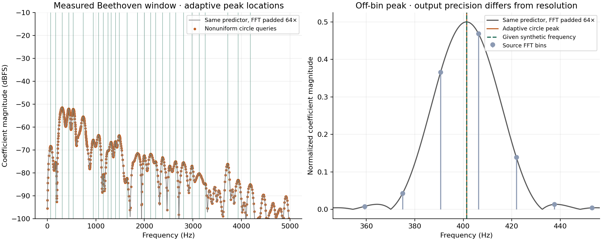

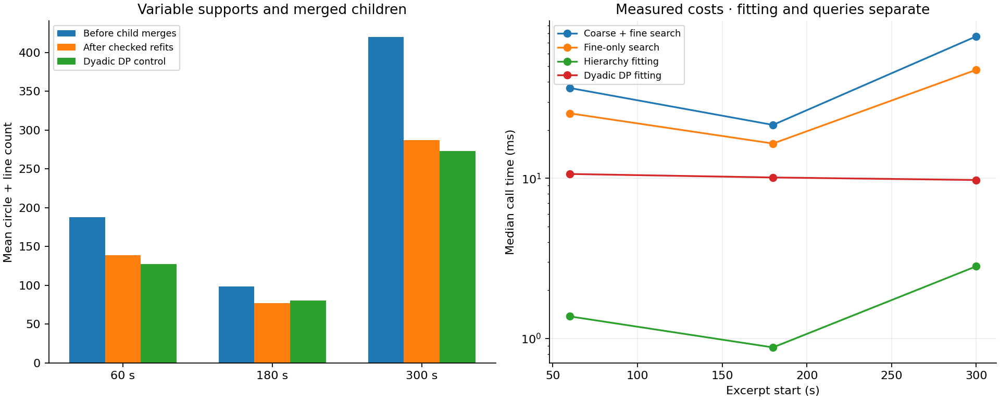

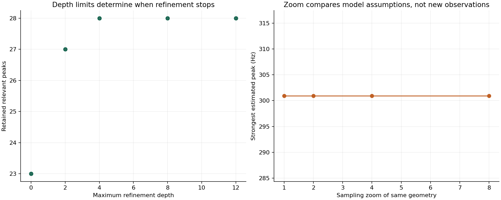

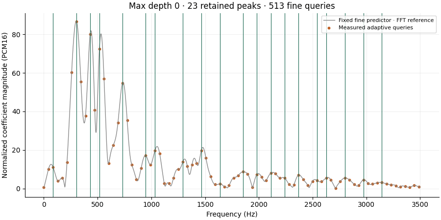

The silent GIF contains five actual searches at depths 0, 2, 4, 8 and 12 over the
same fixed predictor. It does not invent intermediate frequencies or animate a
hypothetical spectrum. PNG/SVG versions of the graphs are stored together.

Reproduce with optional NumPy/Matplotlib/Pillow/FFmpeg and Cargo:

```sh
cargo test --offline --test geometric_faft --test adaptive_faft
cargo build --offline --release --example adaptive_bench
python3 -m unittest discover -s tests -p test_adaptive_compare.py -v
python3 tools/adaptive_compare.py /path/to/music.mp3 /tmp/adaptive-trial \
  --ffmpeg /path/to/ffmpeg
# Optional: attach an earlier aggregate run to the retry report.
# Add --previous-report /tmp/earlier-trial/report.json
```

Output must be new and outside the repository. Private model/point/dense-sample
JSON is invertible audio information and remains outside source control; only
aggregate reports and rendered figures belong here. `adaptive_bench` exports
private complete frames as JSON Lines; its positional arguments are documented
in the source. The integral AFT, dyadic geometry and FFT-based phasor controls
remain available unchanged.

## Geometry-first sampled spectrum (earlier FAFT attempt)

This attempt followed the distinction between fitting circles through **waveform
points** and finding rotating phasors through an FFT. Its spectrum is the sampled
DTFT of the fitted curve (optionally zoomed), not the curve's transform; see
[FAFT.md](FAFT.md). The pipeline was:

```text
waveform points → circumcircle centers/radii/angular endpoints
                → tested coverage + per-circle precision
                → finite geometric sums → time-local spectrum
```

[src/geometric_faft.rs](../src/geometric_faft.rs) provides `GeometryFrame`,
`GeometryParams`, retained `WaveCircle` descriptors, `evaluate`, `decode`,
`dtft`, `hann_dtft`, `spectrum_closed`, and `spectrum_rotations`.
There is **no FFT, numerical integration, or spectral fitting** in this path.
The FFT-based `phasor_fft::PhasorFrame` (formerly `faft::FaftFrame`) remains a control; `AngularFrame`
remains the integral reference preset. All three have distinct model definitions.

### What is fitted and optimized

A candidate uses the source values at its first, interior, and terminal points.
It fits an actual circumcircle using `Circle::through`, retains center `(cx,cy)`,
radius, local x scale, and the three unwrapped angles, then predicts amplitudes
with equal angular progress on each side of the interior point. The interval
lengths tried are 1, 2, 4, …, `max_span` (2..256). Circle candidates require at
least two intervals; one interval is always available as a finite endpoint line.
The terminal anchor at N is source sample 0, explicitly closing the period.
The accepted half-open ranges cover every source sample once.

The point bank tries interior positions at 1/4, 1/2, and 3/4 of a support and
aperture gains 0.5, 1, and 2. This varies both point spacing and angular phase.
Local x is `(sample_position-start)*x_scale`, with
`x_scale=2*gain*max(triplet_range,1e-12)/support_length` after frame peak
normalization. Centers, radii, and x scales therefore belong to normalized,
amplitude-scaled coordinates, not raw sample indices. Equal-angle interpolation
uses time to advance the angle; its horizontal circle projection is generally
nonuniform between the three fitting points.

Each candidate tests **all covered samples and the terminal anchor** against an
absolute amplitude-error budget. After parameter rounding, all three fitted
horizontal coordinates are checked too, using the same tolerance in the scaled
coordinate units. This makes the retained center, radius, x scale, and angles
consistent to a declared numerical tolerance. A fitted circle before quantization
passes through the three source points within finite fitting roundoff.

Dynamic precision chooses one significand width per circle across its seven
fields: cx, cy, radius, x scale, and three angles. Line endpoints have their own
width. The bank tries the requested minimum and 12, 16, 20, 24, 32, 40, 53 bits
as applicable; each field keeps its own binary exponent. Signed normalized fields
cost `11+significand_bits` in the hypothetical model. Subnormal rounding and the
53-bit escape are explicit. Precision is validated after rounding, never inferred
from radius alone. Thus two circles can use different amplitude ranges and
parameter widths. This is distinct from encoded audio bitrate.

Dynamic programming minimizes `(circle + line count, hypothetical model bits)`
within this bank. This is a shortest coverage path over candidate supports,
not the earlier FFT best-basis search. A circle counts once even though its two
angular halves can have different angular rates. A line is its explicit
zero-curvature limit; no infinite radius is stored. Fits with normalized radius
above 1e6 are rejected as ill-conditioned and shorter/line candidates remain
available. The coordinate floor and determinant epsilon 1e-18 are stated research
choices, not a scale-independent geometric theorem.

The default **prevalidated** search rejects nominal geometry that already fails
the waveform checks before trying its quantizations. An exhaustive precision
control also tries quantizations of those failures; rounding can occasionally
move them inside tolerance. Both are benchmarked. Prevalidation is faster but
can select slightly more descriptors. Minimum counts apply only to the candidates
the selected policy actually admits; arbitrary circles, off-grid fitting points,
residual additions, and global parameter optimization remain outside the search.

The final decode is checked in original amplitude units. Accepted frames satisfy
**maximum source-sample error ≤ `max_error`**, including quantization. RMS is also
reported. Normalization cannot hide a tiny sample beside a huge one: an unresolved
rescaled error returns an error. No original PCM or FFT coefficients are retained.
There is no intersample, derivative, continuity, perceptual, or original-sound
spectrum error guarantee. Adjacent rounded descriptors may differ at their join
by up to the accepted anchor discrepancies.

### Retrieving a spectrum from the circle parameters

For one angular half with m samples, compile its radius/phase once into

```text
y[j] = cy + r*sin(theta + beta*j),  j=0..m-1
G_m(delta) = sum_j exp(i*delta*j)
           = (1-exp(i*m*delta)) / (1-exp(i*delta))
           = exp(i*delta*(m-1)/2) * sin(m*delta/2)/sin(delta/2)
H(omega) = cy*G_m(-omega)
         + r/(2i) * (exp(i*theta)*G_m(beta-omega)
                    - exp(-i*theta)*G_m(-beta-omega))
```

Multiply by the negative-exponential phase for its support start and sum the
pieces. A line uses `first*G_m(-omega) + slope*sum_j j*exp(-i*omega*j)`; the latter
is obtained from a rational first moment, with stable limiting series near DC.
These are **finite sampled sums**, with no numerical integration and no expansion
of every original sample during a query. The general finite-series identity is
explained in [Julius O. Smith's DFT derivation](https://dsprelated.com/freebooks/mdft/DFT_Derived.html).
This application to fitted piecewise waveform circles is the present experiment.

The implementation uses an anchored sine difference to reduce cancellation for
flat arcs, sinc/Dirichlet limits near resonance, and compensated accumulation.
`closed` computes the stable expression per piece/frequency; `rotations` advances
the numerator, denominator, and support phase along a frequency grid by complex
multiplication. Roots are reanchored every 64 bins, with direct stable fallback
near small denominators. A one-sample piece needs only its value and support
phase. The second attempt also reuses candidate half-angle preparation and
computes line moments rationally away from small denominators.

For P prepared pieces and K requested frequencies, query work is **O(PK)**.
A full native spectrum has K=floor(N/2)+1. If P grows proportionally to N, this
remains quadratic; it has no general FFT complexity advantage. The benefit here
is querying fewer frequencies from fewer retained geometric pieces, reusing the
fit for many windows/queries, and avoiding integration and per-sample trigonometry.
Fitting tests source samples and is separate work, bounded by the explicit
maximum span, point/phase bank, and precision bank.

A spectrum “at a point” is defined over a finite window around that time.
`dtft(omega, start..end)` crops the retained pieces and gives phase origin at
`start`. `hann_dtft` applies a periodic Hann to the **already fitted predictor**
using three shifted finite sums:
`0.5*H(omega)-0.25*H(omega-shift)-0.25*H(omega+shift)`, with
`shift=2*pi/window_length`. Neither query refits the waveform. Pass raw samples
when this continuous sequence of window queries is desired. The benchmark below
instead applies Hann before fitting to match the earlier reference comparison.

### Repeated Beethoven trials

The supplied track is decoded read-only to 44.1 kHz mono PCM16. Two-second
excerpts at 60, 180, and 300 seconds provide 171 possible N=1,024, hop=512 windows
per excerpt. This experiment selects **21 evenly spaced windows per excerpt**:
63 windows, including each midpoint. Nine fitting policies give **567 checked
reconstructions**. This selection is narrower than the older 513-window survey.
Independent Python predicts from exported centers/radii/angles and verifies both
spectral methods against NumPy FFTs of the **same predicted samples**. Source-FFT
differences are reported separately from retrieval arithmetic discrepancies.

At maximum source-sample error 16 PCM16, repeated geometry definitions give:

| Candidate bank | Mean descriptors, 60 s | 180 s | 300 s |
|---|---:|---:|---:|
| Span ≤8, midpoint, f64 fields | 140.05 | 128.29 | 248.95 |
| Span ≤32, midpoint, f64 fields | 102.62 | 64.62 | 234.57 |
| Span ≤128, midpoint, f64 fields | 100.95 | 60.05 | 233.86 |
| Span ≤128, phase/aperture search, f64 | 87.48 | 52.10 | 199.95 |
| Same, adaptive precision, exhaustive control | 86.00 | 51.43 | 196.86 |
| Same, adaptive precision, prevalidated | 87.48 | 52.10 | 199.90 |

The prevalidated result uses 64.14, 35.00, and 152.33 circles per frame, with
23.33, 17.10, and 47.57 lines. Sample RMS errors are **6.79, 6.94, 6.80 PCM16**;
maximum errors are **15.982, 15.981, 15.982**. Parameter widths of **8, 12, 16,
and 20 bits** occur in this policy. Relative complex discrepancies from source
FFT are **1.90%, 2.70%, 0.399%**. The same-predictor spectral discrepancies are
**1.18e-13, 6.99e-14, 7.98e-14** for batched rotations and about 2e-14 for closed
sums. Thus the largest error is the chosen waveform approximation, not retrieval.

The first excerpt's strong-bin median magnitude difference is **1.10 dB** and
median phase difference **7.43°** at this budget (bins above source peak−60 dB,
both spectra above the threshold, DC/Nyquist excluded). Dominant bins agree in
20/21 windows. Within 8–22.05 kHz the complex difference is about **202%**, where
source energy is weak: the circle approximation can generate high-frequency
content. A small full-spectrum relative error does not protect quiet spectral
bins or phase. Tighter error policies are recorded in the snapshot and must be
used when those differences matter.

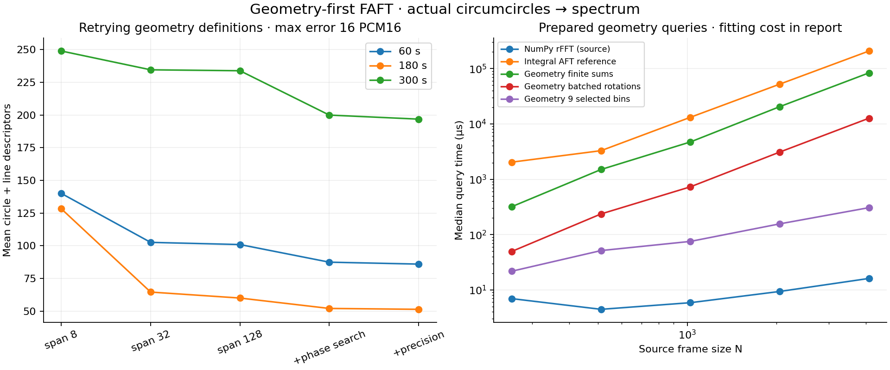

[Vector figure](figures/geometric-faft-20260930/geometric-search.svg).

The size sweep uses the first excerpt's central location, prevalidation,
max error 16, span ≤128, phase search, and adaptive precision. Medians use five
warmed Rust calls and 101 NumPy calls, timed inside their processes. Allocation
is included; decoding audio, windowing, process startup, JSON transfer, and plots
are excluded. Integral AFT geometry preparation is excluded from its query column.
macOS arm64, Rust 1.98.1 release, Python 3.12.14, NumPy 2.3.5.

| N | Fit, ms | Closed sums, µs | Batched rotations, µs | Nine frequency queries, µs | Integral reference, µs | Source rFFT, µs |
|---|---:|---:|---:|---:|---:|---:|
| 256 | 1.974 | 318.88 | 49.54 | 21.75 | 2,035.62 | 6.96 |
| 512 | 5.264 | 1,499.75 | 236.04 | 51.38 | 3,283.12 | 4.46 |
| 1,024 | 9.878 | 4,715.92 | 728.88 | 75.25 | 13,161.54 | 5.88 |
| 2,048 | 19.894 | 20,484.25 | 3,096.00 | 156.17 | 52,290.08 | 9.38 |
| 4,096 | 39.667 | 83,649.04 | 12,679.29 | 306.62 | 207,656.25 | 16.12 |

The first 1,024-sample attempt took **40.314 ms fitting, 4.820 ms closed sums,
1.053 ms batched rotations**. The retry took **9.878 ms, 4.716 ms, 0.729 ms**,
respectively. Prevalidation also changes the admissible candidate set slightly:
47 circles +22 lines became 45 circles +25 lines at that size/location.
This is a measured algorithm/policy tradeoff, not an identical-model speed test.
The full operation still needs fitting plus querying for new geometry; standard
FFT is substantially faster for a complete source spectrum. Fitting reuse and
selected-frequency queries are the relevant next performance targets.

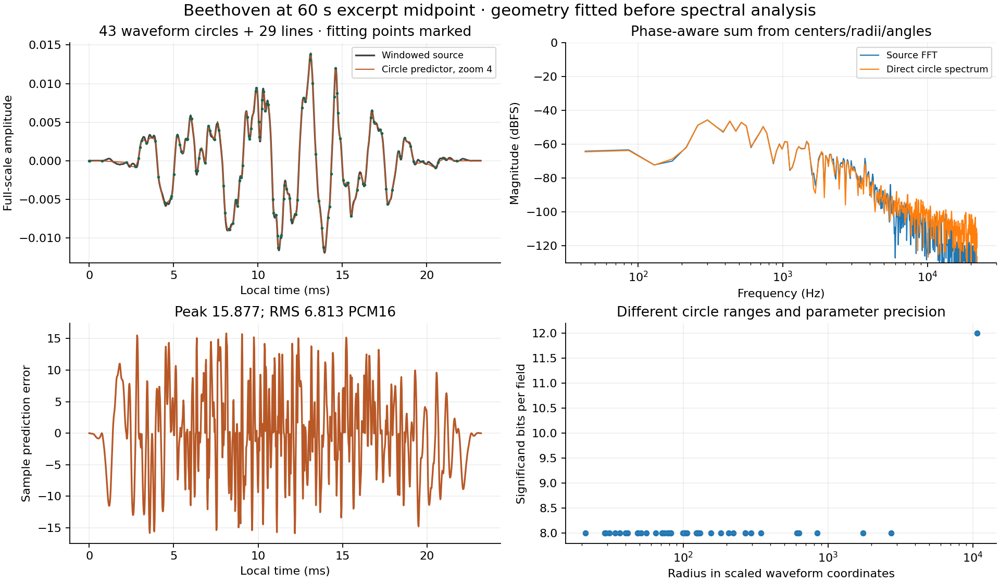

[Vector figure](figures/geometric-faft-20260930/geometric-model.svg).

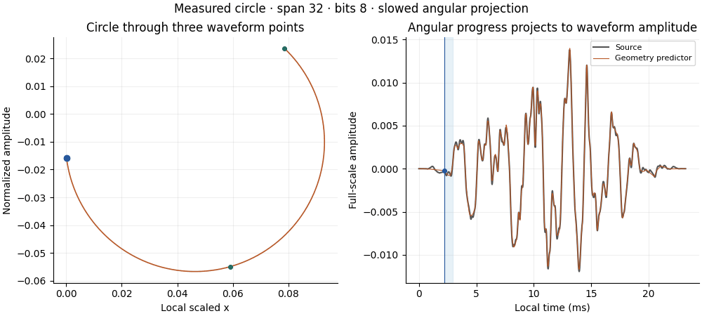

This silent, slowed GIF shows an actual retained circumcircle through its three
fitting points. Its left axis is local scaled geometric x; its right axis is time.
Two angular rates carry it through the middle point. It is not an FFT epicycle.
The frame uses the tested predictor, including its other circles and finite lines.

### Point density, zoom, phase, and encoded bitrate

These experiments distinguish three controls:

- **Measured point density:** retain every second/fourth source sample and fit
  circles to that data, then test the omitted values independently.
- **Parameter precision:** vary geometry significand widths, with errors checked
  after rounding. These widths are per-circle parameters, not audio bits/second.
- **Model zoom:** evaluate a fixed circle function at 2, 4, 8, or 16 samples per
  original interval, and retrieve its corresponding spectrum directly. The
  transform is divided by zoom to retain amplitude×source-sample units; only the
  original frequency range is reported. This does not measure additional data.

All six sparse-point trials satisfy the 16-unit limit on retained points. For
stride 4, omitted-point RMS errors are **12.47, 7.42, 75.22**, and maximum errors
are **91.71, 25.45, 587.65 PCM16**, at 60/180/300 s. In particular, a good sparse
fit cannot inherit its source-point bound at unknown positions. There is no
anti-alias filter in this diagnostic: it intentionally measures point omission,
not a valid lower-sample-rate audio conversion.

For the selected first-excerpt frame, zoom 1..16 leaves relative source-FFT
differences near **4.65%**. Same-curve verification remains around 1e-13. Zoom
changes how the predicted curve is sampled but gives no clear source-prediction
improvement in this test. Curve-generated spectral detail is not restored audio.

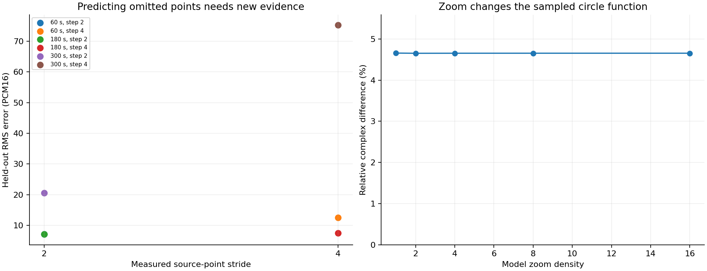

[Vector figure](figures/geometric-faft-20260930/geometric-prediction.svg).

Actual encoded-bitrate controls also re-encode the first two-second **mono decoded
excerpt** at 80 and 160 kbps MP3, preserving 44.1 kHz and decoding gapless metadata
before selecting the same 21 windows. These are additional lossy encodes of an
already MP3-decoded source, not the same as a 320/160/80 kbps stereo encoder trial.
Their decoded spectra differ from the original mono reference by **5.13% and
5.02%**. Geometry uses about **84.90 and 85.57 descriptors/frame**, with its own
source-sample errors below 16. The circle model's spectral differences from each
re-encoded input are **2.03% and 1.99%**. Encoding changes the canonical input;
these controls do not establish that circle prediction restores codec losses.
Real private file sizes are recorded; no circle compression ratio is claimed.

The hypothetical geometry cost includes a 96-bit length/scale header, support
span-minus-one, type, precision, middle-position and aperture-gain tags, and all
geometry fields with exponents/significands. It is only a search cost; Rust model
objects and cached angular pieces occupy more memory. A wire format and measured
bytes per circle remain separate work.

### Reproduce and next experiments

```sh
cargo test --offline --test geometric_faft
cargo build --offline --release --example geometric_bench --example aft_bench
python3 -m unittest discover -s tests -p test_geometric_compare.py -v
python3 tools/geometric_compare.py /path/to/music.mp3 /tmp/geometric-trial \
  --ffmpeg /path/to/ffmpeg
```

NumPy, Matplotlib, Pillow, FFmpeg/libmp3lame, and Cargo are optional research-tool
requirements. Output must be new and outside the repository. Exported model JSON,
dense sample predictions, and re-encoded audio are invertible audio data and
remain private. An optional `--previous-report` retains first-attempt aggregate
measurements for retry comparisons. Published results are the
[aggregate snapshot](experiments/geometric-faft-beethoven-20260930.json) and the
rendered figures above. The existing resampler and its triplet contracts remain
unchanged; this experiment fits separate geometry rather than modifying Analysis.

Validation passed **32 Rust tests including the doctest**, all **17 optional
Python tests**, formatting, Clippy and rustdoc with warnings denied, release
examples, the release CLI build, and the existing codec example. Frozen reference
vectors passed. Live ancestor cross-validation was not rerun; its resampler
geometry and synthesis are unchanged. Local links and rendered figures/GIF were
checked. The extreme-range/subnormal repairs are covered by synthetic tests and
do not change the PCM16 experiment's geometry or spectral operations.

Next: prune the point/phase bank with measured error bounds, reuse geometry across
neighboring time windows, try parent/child parameter deltas and residual circles,
make spectral phase/error part of a stated objective, and compare selected-bin
queries with matched source FFT/Goertzel queries. Current operation counts and
error budgets are explicit; there is no universal fastest-transform claim.

## FFT phasor control (earlier FAFT prototype)

This **FFT-based control** was the first FAFT prototype (Fast Angular Fourier Transform with circle
optimization). The earlier integral AFT is retained unchanged as a **reference
preset** for its continuous angular interpolant. FAFT uses rotating vectors and
real projections; it does not integrate the old fitted arcs faster or reproduce
their continuous spectrum. It is an experimental representation and search built
on a conventional FFT, not a newly discovered faster-than-FFT algorithm.

### Circles, child blocks, and the line limit

A circle fitted through three points in the time/amplitude plane and a rotating
phasor circle are different objects. A retained phasor contributes

```text
c = a + i*b = radius * exp(i*phase)
y_k(t) = Re(c * exp(i*2*pi*k*t/L))
       = a*cos(2*pi*k*t/L) - b*sin(2*pi*k*t/L)
y(t) = baseline(t) + sum_k y_k(t)
```

Time is the angle driver; summing circle projections builds the waveform.
The local period is L samples. Interior positive bins use `c=2*DFT[k]/L`;
DC and Nyquist use `c=DFT[k]/L`, with zero imaginary component. A single projected
circle describes one real sinusoid; the corresponding complex DFT has two
conjugate bins. The continuous fractional-time extension is specified by these
projections, not by the original triplet interpolation.

[src/phasor_fft.rs](../src/phasor_fft.rs) (formerly `src/faft.rs`) implements safe
f64 radix-2 butterflies with angle rotations, inverse reconstruction, and
`PhasorFrame` (formerly `FaftFrame`) model selection. The exact
kernel is O(N log N) and agrees with the sampled DFT. This is the established
[FFT factorization](https://www.fftw.org/~fftw/fftw-paper-ieee.pdf); the experimental
part here is the choice of support, baseline, circles, and precision. Power-of-two
frames of at least two samples are currently required for model optimization.
The standalone `transform` also supports a singleton. No integral, quadrature,
external FFT library, or resampler refit is used in FAFT.

For each dyadic support, the search tries a constant mean and an endpoint line,
then transforms the residual. It retains the largest-energy circles sufficient
for the tightened RMS budget and assigns precision. A parent competes with its
two child supports, recursively down to `min_block`. Children **replace** their
parent and partition its sample range; they are not additive residual circles
or predictions inferred from the parent alone. Their parameters come from the
source samples. No gaps or overlap are allowed.

The search minimizes `(baseline + circle descriptor count, estimated model bits)`
lexicographically. Counting the baseline prevents a misleading zero-circle
solution made of many short lines. Dynamic programming finds the best partition
among the generated candidates using the same per-leaf RMS limit. It does **not**
find a globally minimal set of arbitrary-frequency circles, fit optimal trends,
optimize a shared tree-wide distortion budget, or find the globally cheapest
precision allocation. The full dyadic search is O(N log² N), with at most two
inverse checks per candidate. Setting `min_block=N` keeps only the root search.

Three distinct collinear points have no finite circumcircle. They can be viewed
as a zero-curvature limit, so `LineLimit` explicitly stores finite endpoints and
evaluates their affine interpolation. No infinity is stored and no subtraction
of huge centers/radii is needed. For a tangent circle,
`r-sqrt(r²-t²) = t²/(r+sqrt(r²-t²))` tends to zero as r grows; tests check this
stable limit, including a sloped line. This geometric limit is **not** the same
as setting a phasor's frequency to zero, which gives a constant. Existing
`Circle::through` degeneracy behavior and resampler contracts are unchanged.

### Dynamic precision and the error contract

Each frame is internally normalized by its peak amplitude. Every retained circle
chooses its own signed Cartesian mantissas and binary exponent: 2–30 bits per
component, or unquantized f64 when needed. Radius and phase are derived from those
components. DC/Nyquist require only one component. This supports different
amplitude ranges and precisions per circle, without making polar phase unstable
near zero radius.

For this orthogonal local grid, squared RMS error is the sum of discarded
coefficient energies plus quantization energies. An interior circle has weight
1/2; DC/Nyquist have weight 1. The current allocator reserves a 2% RMS margin,
selects the shortest energy-ranked prefix meeting that budget, and distributes
the remaining squared-error allowance equally across retained circles. It tries
increasing precision, then verifies actual inverse reconstruction. An f64 retry
handles a failed quantized candidate; unresolvable tolerances are rejected.
The whole decoded frame is checked again after rescaling.

The guarantee on accepted frames is **sample-domain RMS ≤ `max_rmse`**, in input
amplitude units. This is not a peak-error, intersample, continuity, or perceptual
guarantee. Independent Python synthesis also verifies every benchmark model by
directly summing the retained projected circles. Decode needs no source PCM.
`evaluate(t)` defines the piecewise function on `[0,N)`; child joins may jump and
are not overlap-added. A streaming codec would need a separate boundary policy.

`estimated_model_bits` is a transparent search cost, not a bitstream: 32 bits for
length, 64 for frame scale; one flag per tree node; one baseline-kind flag, 64/128
baseline bits and a 32-bit circle count per leaf; then `log2(L)` frequency bits,
a 7-bit precision tag, and either a 16-bit exponent plus one/two mantissas or
one/two f64 values per circle. There is no serializer, entropy coding, rate in
bits/second, or measured compression ratio. Descriptor minimization can choose a
model with slightly more estimated bits than the root-only control.

### Beethoven measurements, 2026-09-30

The supplied track was decoded read-only to mono PCM16 at 44.1 kHz. As in the
reference experiment, two-second excerpts at 60, 180, and 300 seconds supply
171 windows each: **513 frames**, N=1,024, hop=512, with a periodic Hann applied
before all methods. Three RMS budgets (1, 16, 128 PCM16 units), root-only and
dyadic searches produced **3,078 independently checked reconstructions**.
These are windowed-frame experiments, not reconstruction of an overlap-added
full track. No audio, decoded arrays, or invertible model parameters enter Git.

The unoptimized rotation kernel's relative complex L2 discrepancies from NumPy
rFFT are **3.36e-16, 3.37e-16, and 3.70e-16** for the three excerpts. This checks
the same discrete transform target. The integral reference computes a different
continuous target; its earlier spectral differences remain relevant only to that
model. All requested reconstruction RMS limits were met after quantization.

At a requested RMS limit of **16 PCM16 units**:

| Excerpt | Root circles/frame | Tree circles/frame | Tree blocks/frame | Tree measured RMS | Largest sample error | Root search, µs | Tree search, µs |
|---|---:|---:|---:|---:|---:|---:|---:|
| 60 s | 43.49 | 43.09 | 1.24 | 15.45 | 90.58 | 151.29 | 794.58 |
| 180 s | 24.47 | 24.47 | 1.00 | 15.45 | 78.30 | 151.12 | 771.46 |
| 300 s | 122.23 | 120.77 | 1.78 | 15.49 | 90.20 | 171.46 | 960.79 |

The tighter RMS=1 tree uses 145.41, 106.57, and 263.39 circles/frame; RMS=128
uses 6.19, 2.95, and 45.87. These tradeoffs discard real signal content. The
child search makes only small descriptor improvements on these windows and
costs substantially more than root-only selection. A synthetic signal changing
from bin 5 to bin 17 halfway through a frame does select two one-circle children.
That demonstrates time-local adaptation, not a general advantage on music.

Precision varies across circles: **2–16 component bits** occurred for the
RMS=16 trials; across all trials it ranged from 2 to 21. The f64 escape was not
needed in this recording. These are mantissa widths, not total bits per circle.

The size sweep uses the same central position in the first excerpt, RMS=16,
minimum child length 32. Times are medians of 11 warmed Rust calls and 101 NumPy
calls; timings run inside their processes. Result allocations are included.
The rotation kernel uses pre-created complex inputs; NumPy uses real inputs.
Model search includes normalization, both baseline candidates, tree search,
precision selection, decoding, and error checks. Audio decoding, windowing,
process startup, text/JSON transfer, and graphics are excluded. The integral
reference's geometry preparation is separately recorded in the JSON, not added
to its transform column below. macOS arm64, Rust 1.98.1 release, Python 3.12.14,
NumPy 2.3.5, FFmpeg 7.1.1; timing noise is visible at small N.

| N | NumPy rFFT, µs | Rust rotation kernel, µs | FAFT tree search + checks, µs | FAFT decode, µs | Integral AFT reference, µs |
|---|---:|---:|---:|---:|---:|
| 256 | 4.79 | 3.88 | 126.00 | 4.38 | 1,326.79 |
| 512 | 4.29 | 10.25 | 411.58 | 11.33 | 3,417.79 |
| 1,024 | 5.83 | 16.04 | 706.04 | 17.54 | 13,058.46 |
| 2,048 | 9.29 | 33.25 | 1,688.79 | 36.04 | 52,134.25 |
| 4,096 | 16.12 | 68.88 | 3,848.88 | 76.71 | 207,846.62 |

FAFT removes the quadratic integral path for its discrete target. The Rust kernel
is still slower than optimized NumPy rFFT at N≥512, and optimization is extra
work beyond either FFT. No faster-than-FFT claim follows from comparison with
the integral reference.

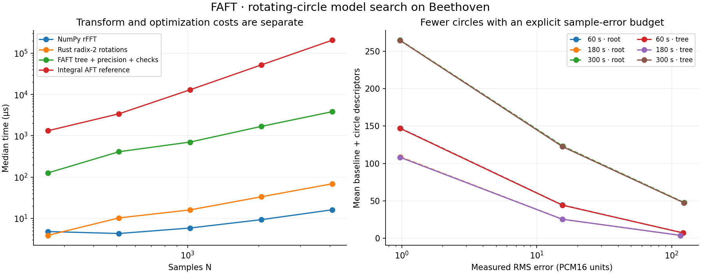

[Vector figure](figures/faft-20260930/faft-benchmark.svg).

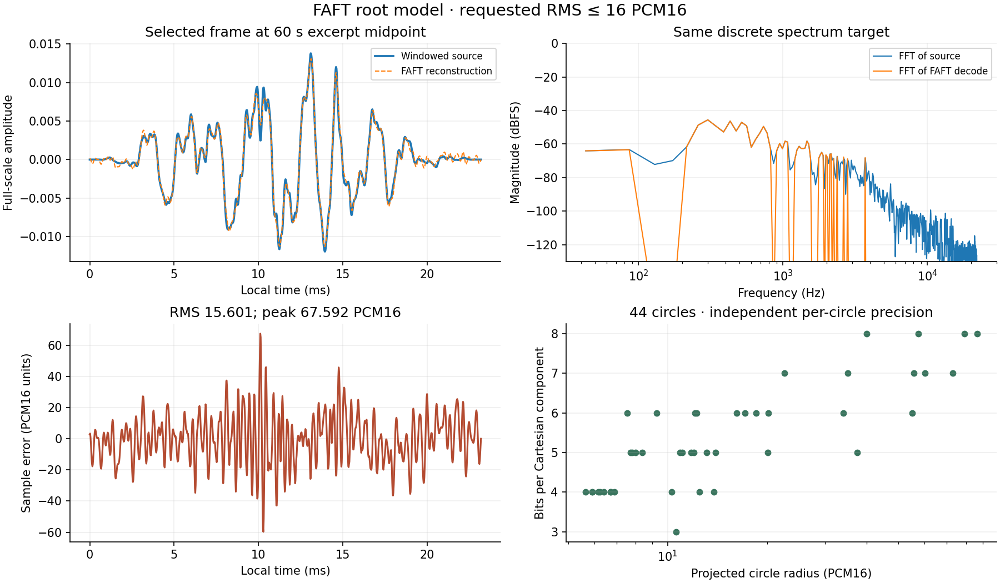

The selected root frame has 44 circles, measured RMS 15.601 and peak error 67.592
PCM16 units. Missing weak spectral bins show the deliberate approximation.
[Vector figure](figures/faft-20260930/faft-model.svg).

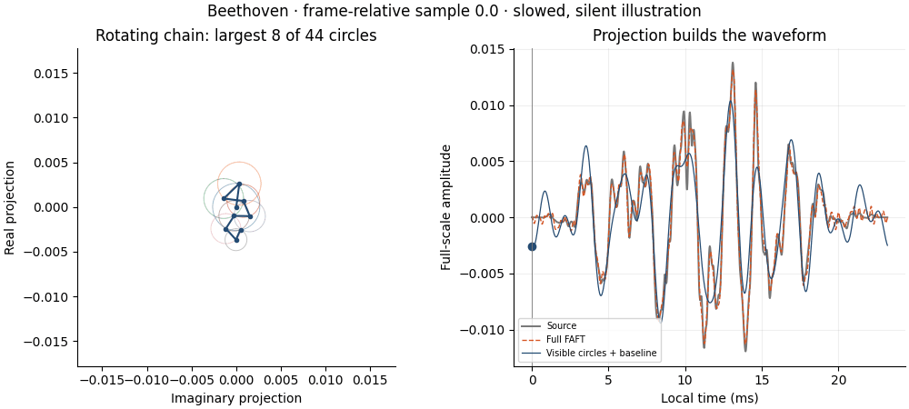

The silent, slowed GIF uses measured coefficients. Its chain shows only the
largest **8 of 44 circles** for legibility; the right panel explicitly compares
that partial projection plus baseline with the full FAFT reconstruction and
source. 48 frames at 10 fps traverse one 1,024-sample window, not 4.8 seconds of
audio. Child support is temporal subdivision, not a constraint that a child
circle's center physically lies on its parent's circumference.

### Reproduce the FFT phasor control

The test, example and tool were renamed with the module; figure/output names from
a new run start with `phasor-` instead of `faft-`.

```sh
cargo test --offline --test phasor_fft
cargo build --offline --release --example phasor_bench --example aft_bench
python3 -m unittest discover -s tests -p test_phasor_compare.py -v
python3 tools/phasor_compare.py /path/to/music.mp3 /tmp/phasor-trial \
  --ffmpeg /path/to/ffmpeg
```

The optional tool needs NumPy, Matplotlib, Pillow, FFmpeg, and Cargo. Output must
be a new directory outside this repository. Its `private-selected-model.json`
can reconstruct the audio frame and must remain private. The published
[aggregate snapshot](experiments/faft-beethoven-20260930.json) includes all repeat
timings, measured errors, circle counts, precision histograms, and support sizes.

Validation passed **27 Rust tests including the doctest**, all **15 optional
Python tests**, formatting, Clippy and rustdoc with warnings denied, release
examples, and the existing codec example. Frozen compatibility vectors passed;
the optional live ancestor cross-validation was not rerun because the resampler
and its geometry are unchanged. Local links and generated plots/GIF were checked.

Next experiments: off-grid frequency refinement to reduce leakage, shared
parent/child residual circles, adaptive distortion allocation, a maximum-error
option, overlap/continuity constraints, and an actual bounded wire format only
after the model cost justifies it. Keeping those as separate steps makes it
possible to identify which changes reduce work, circle count, or measured bits.

## Angular Fourier Transform (AFT): reference preset benchmark

This retained **reference preset** computes a complete frame spectrum from angular
circle functions. **AFT** is the project name for this continuous angular model
plus its analytic Fourier integral; it is not a new Fourier kernel or another
algorithm for the sampled DFT. Compression is outside this experiment.

### Definition and implementation

[src/aft.rs](../src/aft.rs) provides `AngularFrame::new`, `evaluate`, `fourier`,
`spectrum`, and fitting statistics. It fits periodic source halos once. On the
interval between samples i and i+1, it averages the right angular half of the
circle anchored at i and the left angular half of the circle anchored at i+1.
The last interval closes to sample 0. Degenerate halves use the source-pair line.
A circle half is rejected if its endpoint discrepancy exceeds
`1e-8 * max(1, abs(left), abs(right))`; there were no such rejections in this run.
This preserves the circle geometry rather than refitting it during integration.

One frame has period N and covers `[0,N]`. Let g(t) denote this angular
interpolant and x[n] the input samples:

```text
AFT[k] = integral from 0 to N of g(t) * exp(-i*2*pi*k*t/N) dt
FFT[k] = sum from n=0 to N-1 of x[n] * exp(-i*2*pi*k*n/N)
```

Each angular half is integrated analytically using the sinc formula below.
Line halves use sinc and its derivative. Contributions receive their global
midpoint phase and are accumulated with compensated summation. Preparing geometry
costs O(N); one frequency costs O(N); all nonnegative bins currently cost O(N²).
`fourier` also accepts arbitrary positive/negative radians-per-sample frequencies.
There is no oversampling or FFT hidden inside the AFT integration.

This equal average is an explicit new interpolation policy, separate from the
resampler's finite-zoom angular window. Joins reproduce source values within
checked fitting roundoff. The geometry fit is data-dependent: the sample-to-AFT
mapping is generally nonlinear even though integration of a fixed function is
linear. AFT coefficients are not discrete inverse-FFT inputs with an exact
reconstruction guarantee. In particular, the continuous coefficient at Nyquist
need not be real.

### Comparable inputs and controls

The supplied Beethoven track was decoded to **44.1 kHz mono PCM16**, using
FFmpeg's mono downmix, with two-second excerpts at **60, 180, and 300 seconds**.
Each excerpt supplies **171 windows**, for **513 windows total**. Frames contain
1,024 samples (23.22 ms), hop 512 (11.61 ms), and 513 nonnegative frequency bins
spaced by 43.0664 Hz. No source recording or invertible spectral arrays are stored
in this repository.

Both methods receive the identical samples after a **periodic Hann** window,
`w[n] = 0.5 - 0.5*cos(2*pi*n/N)`. Windowing happens before fitting; this is not a
claim to integrate an unwindowed angular model multiplied by a continuous Hann.
The fitting preset is `AnalysisParams::original()` (`SignalRange`, determinant
epsilon 4e-6), in **PCM16 amplitude units**, not normalized unit amplitude.
The absolute fit epsilon makes that scale relevant. Of 1,050,624 prepared
halves, 1,049,496 (99.893%) were circles; the rest were lines.

The FFT reference is NumPy's float64 `rfft`, with the same negative-exponential
convention and no forward normalization. See the [NumPy FFT definition](https://numpy.org/doc/stable/reference/routines.fft.html)
and the [Hann window reference](https://docs.scipy.org/doc/scipy/reference/generated/scipy.signal.windows.hann.html).
A third curve shows the exact Fourier integral of the **periodic linear
interpolant**, `FFT[k] * sinc(k/N)^2`, where this sinc is `sin(pi*x)/(pi*x)`.
That control exposes ordinary interpolation effects rather than attributing all
AFT/FFT differences to numerical error.

For plotted interior positive-frequency bins, magnitude is
`20*log10(2*abs(coefficient)/(sum(w)*32768))` dBFS. DC and Nyquist are omitted from
the plots to avoid mixing their continuous/discrete one-sided conventions. The
statistical complex comparisons use the full reported nonnegative coefficient
arrays. Magnitude/phase statistics exclude DC/Nyquist and require both spectra
to exceed the corresponding FFT window's peak minus 60 dB.

### Spectra and differences

| Excerpt | Relative complex L2 difference from FFT | Median absolute magnitude difference, strong bins | Median absolute phase difference, strong bins | Dense-check discrepancy, q=128 |
|---|---:|---:|---:|---:|
| 60 s | 0.0588% | 0.0352 dB | 0.0056° | 2.11e-08 |
| 180 s | 0.0316% | 0.0238 dB | 0.0026° | 1.34e-08 |
| 300 s | 0.0876% | 0.0638 dB | 0.0109° | 2.21e-08 |

AFT and FFT selected the same dominant non-DC bin in **all 513 windows**. The
small full-spectrum differences are dominated by strong low-frequency energy;
within the 8–22.05 kHz band, relative complex differences are **10.53%, 13.97%,
and 8.49%**, respectively. The FFT remains the reference for the sampled DFT;
these differences do not show that either method is a more accurate estimate
of the unknown continuous recording.

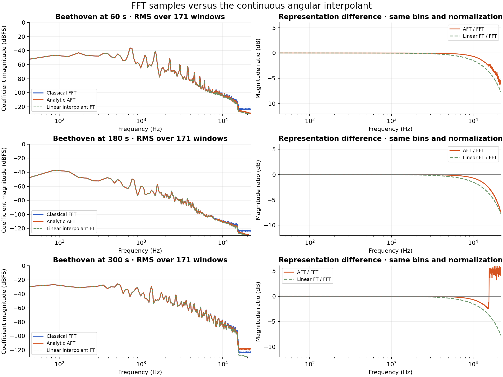

Left: RMS coefficient magnitude across each excerpt's windows. Right: ratios
of those RMS magnitudes, not an average of per-window dB ratios. The angular
model generally preserves more high-frequency magnitude than linear interpolation
in these examples. The extra very-low-level energy above the track's steep
high-frequency cutoff in the 300-second excerpt is model-generated spectral
content, **not evidence of recovered information**. No enhanced frequency
resolution or listening-quality conclusion follows. [Vector plot](figures/aft-20260930/aft-spectra.svg).

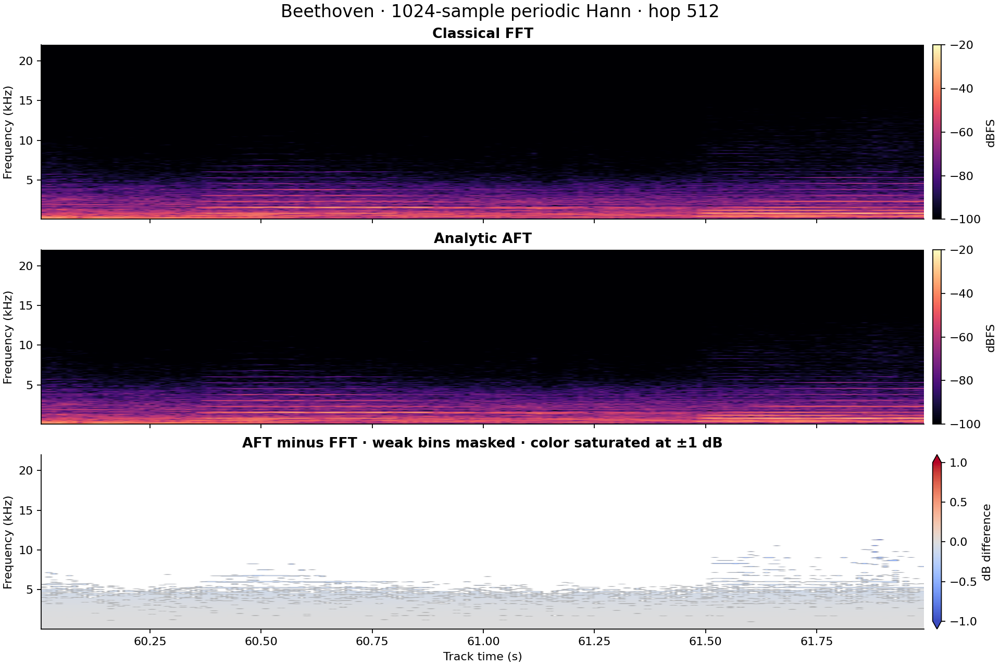

Both spectrograms use identical magnitude color limits. The difference panel
masks FFT bins below −90 dBFS and saturates color at ±1 dB to expose differences
in stronger bins; it is not an error map against known continuous audio.
[Vector plot](figures/aft-20260930/aft-spectrogram.svg).

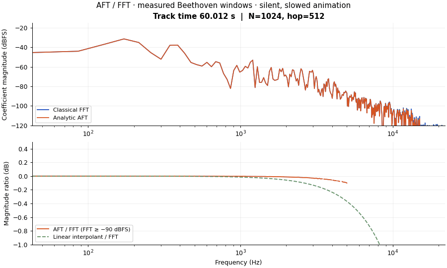

The silent GIF shows **48 measured windows**, selected across 60.012–61.985 s,
at 10 frames/s. Playback is slowed; the displayed time is the actual window
center on the source track. Axes and normalization stay fixed throughout. The
difference plot zooms to −1..+0.5 dB and masks FFT bins below −90 dBFS.

### Current runtime benchmark

Measured on macOS 27.0.1 arm64, Rust 1.98.1 release mode, Python 3.12.14,
NumPy 2.3.5, and FFmpeg 7.1.1. Matplotlib 3.10.8/Pillow 12.1.1 rendered the figures.
The hardware model was not available to the harness. These are measurements of
these two implementations and **different transform targets**, not a universal
algorithm speed ranking.

The size sweep uses the same central track location of the first excerpt.
After warmup, medians use 11 AFT/fit calls and 101 FFT calls per size. Calls are
timed **inside their processes**. Output allocation is included; audio decoding,
windowing, process startup, text/JSON transfer, plotting, and dense verification
are excluded. AFT geometry preparation is separate and must be added when a frame
is new. Complete repeat timings are retained in the JSON snapshot.

| Samples N | FFT median, µs | Geometry preparation, µs | AFT on prepared geometry, ms | AFT / FFT time |
|---|---:|---:|---:|---:|
| 256 | 3.417 | 26.208 | 0.818 | 239× |
| 512 | 4.375 | 57.958 | 3.278 | 749× |
| 1,024 | 5.917 | 114.792 | 13.119 | 2,217× |
| 2,048 | 9.375 | 222.000 | 52.220 | 5,570× |
| 4,096 | 16.167 | 460.417 | 207.780 | 12,852× |

The 1,024-sample track-window medians are approximately **13 ms for AFT**,
**0.11 ms to prepare geometry**, and **6 µs for FFT**. The current AFT is therefore
much slower; the near-quadratic growth is visible. Analytic integration provides
a precise spectrum of the chosen angular curve, not an FFT speedup. No realtime
or other-platform claim is made.

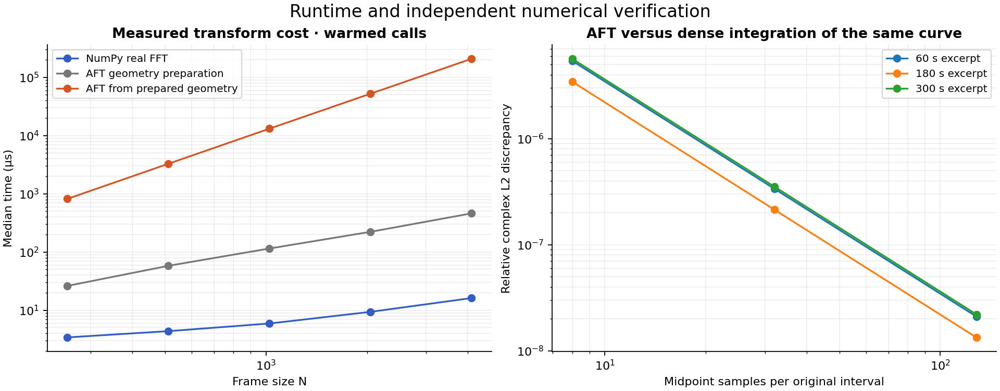

[Vector plot](figures/aft-20260930/aft-benchmark.svg).

### Independent integration check

For the central window of each excerpt, the same angular curve was evaluated
at q=8, 32, and 128 **midpoints per original interval**, then independently
integrated using NumPy's FFT. The integration step and midpoint phase are restored:

```text
numeric[k] = rfft(g((j+0.5)/q))[k] / q * exp(-i*pi*k/(N*q))
```

This check compares the same continuous waveform, unlike the original-sample
FFT comparison. Relative complex L2 discrepancies decrease by about 16× when
q increases by 4×, consistent with midpoint quadrature convergence:

| Excerpt | q=8 | q=32 | q=128 |
|---|---:|---:|---:|
| 60 s | 5.4e-06 | 3.37e-07 | 2.11e-08 |
| 180 s | 3.43e-06 | 2.14e-07 | 1.34e-08 |
| 300 s | 5.65e-06 | 3.53e-07 | 2.21e-08 |

These are convergence measurements on **three selected windows**, not a certified
error bound for every circle. Synthetic tests additionally verify known constants,
phase shifts, conjugacy, periodic coverage, original arc reuse, short inputs,
line interpolation's sinc² spectrum, and independent quadrature. Near-flat arcs
with extreme radii can still be ill-conditioned and need wider numerical study.

### Reproduce the AFT experiment

[tools/aft_compare.py](../tools/aft_compare.py) runs the Rust
[aft_bench example](../examples/aft_bench.rs) and writes summary JSON, PNG/SVG
plots, the GIF, and private complex spectral arrays. NumPy, Matplotlib, Pillow,
and FFmpeg are optional research tools, not Cargo dependencies. Install them in
a separate Python environment. The destination must be new and outside the repo.

```sh
cargo test --offline --test aft --test spectral
cargo build --offline --release --example aft_bench
python3 -m unittest discover -s tests -p test_aft_compare.py -v
python3 tools/aft_compare.py /path/to/music.mp3 /tmp/aft-trial \
  --starts 60 180 300 --seconds 2 --rate 44100 --frame 1024 --hop 512 \
  --sizes 256 512 1024 2048 4096 --ffmpeg /path/to/ffmpeg
```

`--binary` selects an existing release example; otherwise Cargo builds it and
its actual target directory is discovered. The original recording is read-only.
Only the summary and rendered figures are copied into docs; keep
`private-spectra.npz` outside version control because its coefficients can
reconstruct audio. The [complete AFT benchmark snapshot](experiments/aft-beethoven-20260930.json)
contains parameters, numerical results, model counts, and individual timing samples.

Validation passed the complete Cargo suite (22 tests including the doctest),
formatting, Clippy with warnings denied, rustdoc with warnings denied, release
examples, and all 13 optional Python tests. The existing resampler behavior is
unchanged. The older compression investigation follows for historical context.

## Fourier transforms from geometry

The new Rust [spectral module](../src/spectral.rs) has three operations:

- `angular_fourier`: analytic continuous transform of an individual equal-angle
  circle, split at the sample anchor because its two angular slopes may differ.
- `uniform_fourier`: numerical continuous transform of a uniform-x semicircle,
  integrated over its valid extent with an explicit quadrature panel count.
- `frame_dft_bin`: the discrete transform of integer predictions from retained
  frame descriptors, without allocating the decoded PCM or accessing the source.
  This takes O(N) per bin; computing every bin this way takes O(N²).

All use the negative-exponential convention. The continuous APIs integrate over
sample position, with angular frequency `omega = 2*pi*Hz/sample_rate`. Divide the
integral by sample rate to express time in seconds. They operate on individual
unblended functions: they do not include resampler windows or copied originals.

For one angular half, write `y(t) = cy + r*sin(theta + beta*(t-m))` on an interval
of length L centered at m. Define `sinc(x) = sin(x)/x`, with `sinc(0)=1`, and
`Sminus = sinc((beta-omega)*L/2)`, `Splus = sinc((beta+omega)*L/2)`. Its integral is:

```text
exp(-i*omega*m) * L * (
  cy*sinc(omega*L/2)
  + r/2*sin(theta)*(Sminus+Splus)
  - i*r/2*cos(theta)*(Sminus-Splus)
)
```

The implementation uses a small-argument sinc expansion at DC and resonance.
For uniform x, substitute `x_local = cx + r*sin(theta)`. Then
`y = cy ± r*cos(theta)` and `dt = r/aperture*cos(theta)*dtheta`. Midpoint quadrature
in theta avoids the infinite endpoint slope of the semicircle in x. More panels
are still necessary for oscillatory integrands; the API does not certify a
quadrature error bound. Very ill-conditioned large circles remain a limitation.

The continuous integral is not the DFT of the sampled signal. For example, the
uniform semicircle through `[0,1,0]` has area pi/2, the angular sine arc has area
4/pi, and the sampled sequence has DC sum 1. Their differences are intentional.
See Julius O. Smith's [continuous/discrete Fourier definitions](https://www.dsprelated.com/freebooks/sasp/Fourier_Transforms_Continuous_Discrete_Time_Frequency.html)
for the transform conventions. The formulas above are implemented and checked
against independently sampled quadrature, phase shifts, scaling, and known areas.

## What a predicted subcircle can tell us

Restricting a parent circle to smaller time intervals produces **subarcs of the
same circle**. It neither reduces its radius nor supplies new observations.
Predictions at those positions remain identical. Refitting three exact points
from that parent would recover the same circle in exact arithmetic; doing so
numerically is unnecessary and can add rounding error.

To improve prediction, a child must introduce source information. The experiment
bisects sample coverage and selects another already-fitted Rust circle or a line
for each child. It measures parent error and corrected-child error against every
source sample. A parent cannot discover its own error from generated subarcs
alone. A transmitted residual or independently measured child model is needed.

Every circle comes from `Analysis::new` with the default uniform preset on a
normalized PCM16 block. The Python lab reuses its anchor, aperture, center, radius,
and branch. It does not refit circles or modify `Analysis`. At each span it tests
circles anchored at its first interior sample, middle, and last interior sample,
alongside the endpoint line. These are local-triplet circles **extrapolated** over
a larger span, not circles fitted through widely spaced parent endpoints.
Invalid extent or excessive prediction is rejected. Branch mismatch is never
silently accepted as coverage. Child descriptors retain block-relative anchors.

The diagnostics compare parent restrictions with source-informed child choices
at four depths, using squared error. They are diagnostic trees, not necessarily
the exact trees selected for minimum encoded size. Child improvement is measured,
not assumed. The byte search evaluates model-only leaves, split children, raw
PCM, and (where enabled) residual leaves. It chooses the smallest independently
zlib-compressed candidate at each node. This is a local heuristic: different
child bytes can change compression at their parent, so adding candidates does
not guarantee a globally smaller file.

## Methods and error control

[compression_lab.py](../tools/compression_lab.py) compares:

| Method | Predictor/payload |
|---|---|
| `pcm` | PCM16, zlib per block |
| `delta` | First sample followed by first differences as int32, zlib |
| `line_tree` | Recursive lines or raw PCM |
| `circle_tree` | Recursive lines, reused circles, or raw PCM |
| `line_residual` | Line tree plus quantized residual leaves |
| `circle_residual` | Same search with reused circle candidates |
| `fourier_residual` | Largest K real-DFT bins plus residual, or raw PCM |
| `line_fourier_residual` | Endpoint line + K residual bins + remaining residual |
| `circle_fourier_residual` | Best of eligible line/circle bases + K residual bins |
| FLAC | FFmpeg lossless reference encode, independently decoded and checked |

Fourier trials use NumPy's FFT of integer predictor samples and of the source
residual; they do not substitute a continuous arc integral for a DFT. Linearity
lets the two spectra add, but geometry alone does not give the original spectrum
unless prediction error is zero. The K bins are ranked by conjugate-pair energy,
with proper DC/Nyquist handling; coefficients normalized by block length are
serialized as float32. There is no window or overlap-add. Block boundaries and
maximum boundary-jump error are explicitly reported.

For a requested integer maximum error E in PCM16 units, let `q=2*E+1`. Predictors
are decoded, rounded to nearest even, and clipped to PCM16 before residuals are
computed. Encode `round((source-prediction)/q)` as int32. Decode prediction plus
q times residual, then clip to PCM16. This bounds integer error by E, including
at E=0. Geometry is serialized as float64; Fourier coefficients are evaluated
**after** float32 serialization. The full final stream is decoded and compared
with the source. At E=0 the assertion is exact equality of decoded PCM16, not
losslessness relative to the MP3's earlier uncompressed recording.

Raw fallback limits payload growth, but headers and zlib overhead can still make
a stream larger than PCM. All reported sizes include the whole serialized file.
The FLAC reference uses its normal metadata and stereo coding; the research
methods encode channels independently. The PCM denominator excludes WAV headers.
These ratios are not comparisons against the source MP3's encoded size.

## Experimental SWR1 envelope

This tool-local format is not a stable crate API or a general-purpose codec.
There is no compatibility commitment, seeking, streaming, or cross-platform
rounding guarantee. The decoder accepts bounded local experiments; it has
malformed-input tests, but no fuzz/security validation.

All integers/floats use explicit little endian encodings, never native layouts.
The 16-byte file header is `4s magic=SWR1, u32 rate, u16 channels, u16 block,
u32 frames`. Limits are 384000 Hz, 1–2 channels, 2 million frames, and power-of-two
blocks of 4–4096 frames. Blocks appear in channel-major order. Each has a u32
compressed-byte length then one zlib member. Partial final blocks retain their
actual length. Decompression is bounded by `128*frames_in_block+1024` bytes;
truncation, trailing data, excessive sizes, invalid tags/values, and bad coverage
are rejected before acceptance.

Coverage and split positions are implicit in block length and midpoint bisection.
A node begins with one ASCII byte:

- `R`: covered PCM16 values.
- `D`: covered int32 deltas, first sample relative to zero.
- `L`: float64 value at span start and float64 slope, in PCM16 amplitude units.
- `C`: u16 block-relative anchor, four float64 values (aperture, cx, cy, radius),
  i8 branch (+1/-1). Circle amplitudes are normalized by 32768.
- `S`: left then right child. Splits below five samples are rejected.
- `Q`: positive odd u16 q, predictor, then one int32 residual per covered sample.

A Q predictor can be L/C, `F`, or `B`. F is u16 bin count followed by sorted,
unique `(u16 index, f32 real, f32 imaginary)` records; conjugates are implicit.
DC and even-length Nyquist bins must be real. B is L/C followed by F and means
add the Fourier correction to the already-rounded/clipped base, then round/clip
again. F/B are not recursive. Trees are bounded to depth 12. Node tags, parameters,
Fourier bins, residuals, zlib checksums, per-block lengths, and the file header
are all included in the measured size.

## Reproduce

Requires Rust, Python with NumPy, and FFmpeg. Neither NumPy nor FFmpeg is a Cargo
dependency. The script builds the `export_circles` example offline and queries
Cargo's target directory; `--exporter` can select an existing executable.

```sh
cargo test --offline --test spectral
cargo build --offline --release --example export_circles
python3 -m unittest discover -s tests -p test_compression_lab.py -v
python3 tools/compression_lab.py /path/to/music.mp3 /tmp/compression-trial \
  --starts 60 180 300 --seconds 1 --rate 44100 --channels 2 \
  --block 256 --keep 8 --tolerances 0 16 128 --ffmpeg /path/to/ffmpeg
```

The output directory must be new and outside the repository. It contains a
reference WAV/FLAC, each complete `.swr` stream, its decoded WAV, and a JSON report
with sample errors, boundary errors, SNR, node counts, sizes, and wall times.
Reports omit source paths. PCM16 uses no extra gain; no resampling is requested
when the source already matches the specified rate. The input recording is
read-only. Keep all recordings and generated audio outside version control.

## Measured results

Tested on 2026-09-30 using three one-second excerpts of the user-provided
Beethoven MP3, starting at 60, 180, and 300 seconds. Each was decoded to stereo
PCM16 at 44.1 kHz with no gain. Blocks contain 256 samples per channel; Fourier
trials retain eight conjugate-pair bins. Rust 1.98.1, NumPy 2.3.5, zlib 1.2.12,
and FFmpeg 7.1.1 ran on macOS arm64. No subjective listening result is claimed.
The [complete numerical report](experiments/beethoven-20260930.json) includes
per-excerpt times, errors, boundary jumps, and selected node counts.

Across all three excerpts, the reference contains **529,200 PCM bytes**. The
table sums three independent complete files for each setting:

| Method | E=0 bytes | E=16 bytes | E=128 bytes |
|---|---:|---:|---:|
| PCM + zlib | 502,613 | — | — |
| Delta + zlib | 463,310 | — | — |
| Line tree | 502,609 | 497,368 | 346,861 |
| Circle/line tree | 502,609 | 497,355 | 347,066 |
| Line + residual tree | 502,463 | 345,514 | **162,310** |
| Circle/line + residual tree | 502,463 | **345,513** | **162,310** |
| Fourier + residual | 502,613 | 346,690 | 185,486 |
| Line + Fourier + residual | 502,613 | 345,899 | 191,088 |
| Circle/line + Fourier + residual | 502,613 | 345,899 | 191,088 |
| FLAC reference, exact | **190,956** | — | — |

Every stream was independently decoded. All E=0 trials reproduced the decoded
PCM16 exactly; all lossy trials satisfied their maximum error bound. At E=16,
circle/line residual coding uses 65.29% of PCM, with aggregate RMS error 9.46
PCM16 units. It saves just **one byte** over line-only residual coding across
three files. At E=128 it uses 30.67%, ties line-only coding exactly, and has RMS
error 73.40 units. Its per-excerpt SNR ranges from 16.58 to 32.84 dB; maximum
sample error alone should not be read as transparency.

FLAC uses 36.08% of PCM with **zero** error, substantially better than these
research methods at E=0 or E=16. Its usual stereo prediction and larger blocks
are advantages that this lab intentionally does not reproduce. The E=128
size reduction below FLAC trades away fidelity. None of this establishes a
competitive circle audio codec.

The circle/line+Fourier methods selected **zero circle bases** in the saved files
at every tolerance. At E=16 the recursive circle residual files retained four
circle descriptors total; at E=128 they retained none. This is evidence against
paying for the current full-precision local-circle descriptors in these settings,
not evidence that every circle representation must fail. Model-only trees can
get slightly larger when circles are offered because node-local zlib costs do
not optimize the final parent's compressed size.

Source-informed subdivision does improve prediction in the diagnostic search:

| Excerpt offset | Whole-block predictor RMSE | After four subdivision levels |
|---|---:|---:|
| 60 s | 769.99 | 165.07 |
| 180 s | 514.35 | 37.98 |
| 300 s | 4,078.05 | 812.95 |

These errors are PCM16 units, before transmitting residuals. The table describes
line/circle candidate selection on smaller spans; a restricted parent alone has
unchanged predictions. The improvement requires child/source information, whose
parameter cost is then counted in the encoded trials.

The next useful experiments are wider-span parent fits as an explicitly separate
policy, quantized/delta-coded child geometry, and residual coding with a stronger
entropy model. Sweep block size and Fourier budget and compare matched measured
RMS/maximum error before interpreting small byte differences. Broader music,
speech, transients, silence, longer excerpts, other machines, and blind listening
remain untested. The synthetic suite covers ideal circles, tones, ramps, silence,
noise, short blocks, clipping endpoints, and malformed envelopes.

Validation recorded for the earlier compression experiment passed the complete
Cargo suite (including its spectral tests and doctest), formatting, Clippy with warnings denied, rustdoc,
release build, and the existing codec example. All 10 optional Python tests ran
with NumPy/FFmpeg available. Live validation passed 144 Rust/C/Python comparisons
without modifying frozen fixtures. All 69 saved SWR1 files were reopened and
their decoded lengths, node counts, and full file sizes checked against the report.
