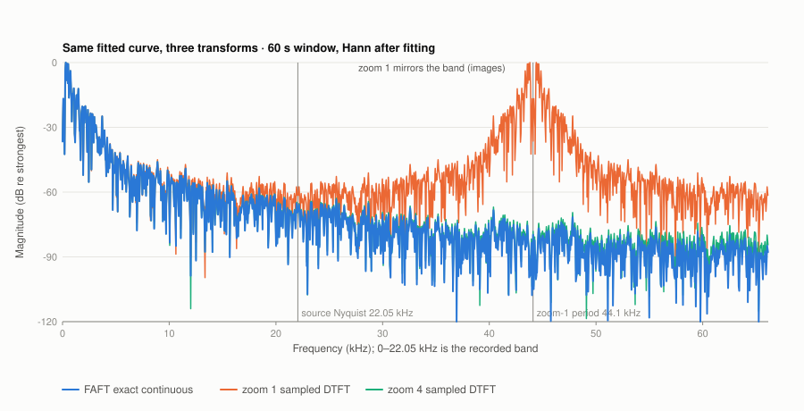
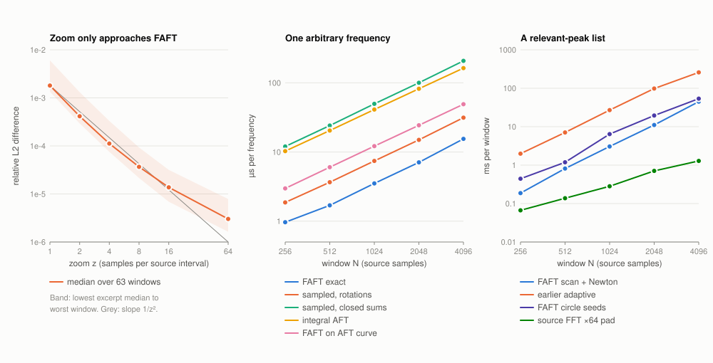
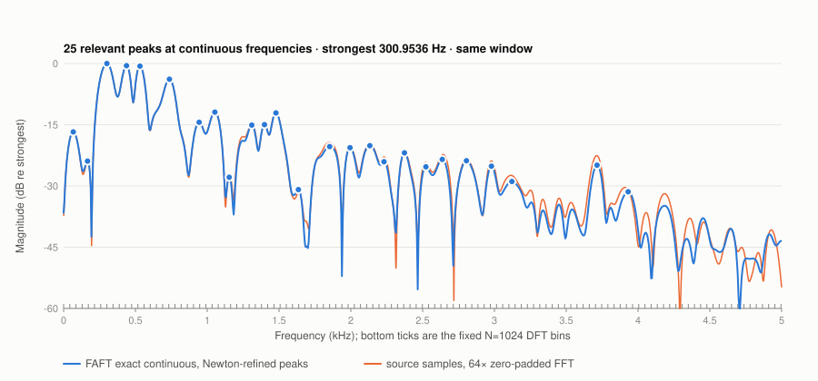

# FAFT: the Fourier transform of determined circles

This is the reference definition of FAFT (Fast Angular Fourier Transform) in this
crate. It is implemented in [src/faft.rs](../src/faft.rs), tested in
[tests/faft.rs](../tests/faft.rs), and measured with
[examples/faft_bench.rs](../examples/faft_bench.rs) and
[tools/faft_compare.py](../tools/faft_compare.py). The earlier experiments in
[COMPRESSION.md](COMPRESSION.md) remain as controls. This page says which of them
are, and are not, the transform.

## Three things that were mixed together

| Stage | What it does | Where | Output |
|---|---|---|---|
| Circle determination | Three source points fix one circle; circles are accepted only if they reproduce the covered source samples | `GeometryFrame` (`geometric_faft`), triplet `Analysis`/`AngularFrame` | Circle geometry over time supports |
| Zoom (SinWhisky) | Evaluates the circle curve at fractional positions | `resample`, `CircleCurve::evaluate` | More samples of the same curve |
| FAFT | Integrates that curve against `exp(-i*omega*t)` in closed form | `faft::Faft` | A function of any real frequency |

The earlier "geometry-first" and "adaptive" spectra evaluated a *sampled* DTFT of
the circle curve, with `zoom` as a parameter of the transform. Sampling more
densely only approaches the transform of the circles. The difference was
measured (below). With zoom `z`, Poisson summation gives:

```text
sampled_z(omega) = sum over m of FAFT(omega + 2*pi*z*m)  +  half-jump terms at joins
```

So a zoomed spectrum is the FAFT plus spectral **images**, and zoom 1 mirrors
the audio band above the source Nyquist. `geometry_curve_is_the_fitted_predictor_and_zoom_only_samples_it`
checks this identity numerically, including the images and the tolerance-bounded
value jumps where rounded circles meet. Zoom stays what SinWhisky made it: a way
to synthesize samples. It is not a transform parameter.

The FFT-based rotating-phasor optimizer that was first published as "FAFT" is a
radix-2 FFT with coefficient selection. It never used the fitted circles, so it
is now named `phasor_fft` (see [Renamed control](#renamed-control)).

## Definition

### Circles as rotations

An equal-angle half of a determined circle is a finite rotation:

```text
y(u) = center + radius*sin(phase + rate*u) + slope*u,    0 <= u < length
```

`center` and `radius` belong to the circle, `phase` is the angle at the start of
the support, and `rate` is the angle swept per source sample. A finite line is
`radius = 0` with a slope. The support `[start, start+length)` is in source
samples. `CircleCurve` holds contiguous rotations covering `[0, N)`. Two rotations
may share one support and add; this is how the AFT's averaged halves are
represented. `CircleCurve::from_geometry` takes both halves of every
`GeometryFrame` circle and every line unchanged. `CircleCurve::from_angular`
takes the integral AFT model unchanged. Neither refits anything.

`rate` is a geometric angular speed fixed by the circle and its horizontal
scale. It is not, in general, a frequency of the recorded sound; see
[circle references](#circle-references-are-not-the-spectrum).

### The transform

For a window `[p, q)` of duration `T = q - p` and any real `omega` (radians per
source sample):

```text
FAFT(omega) = integral from p to q of y(t) * w(t) * exp(-i*omega*(t-p)) dt
```

`w` is 1 (rectangular) or the continuous periodic Hann
`1/2 - 1/2*cos(2*pi*(t-p)/T)`. `value` divides by the weight sum (`T` or `T/2`),
so a unit sinusoid has magnitude about 0.5. `integral` returns the unnormalized
amplitude·sample value. There is no bin grid. Frequencies above pi are defined;
there they show the curve's own model-generated content, not recorded content.

With `E(delta, L) = integral_0^L exp(i*delta*u) du = (exp(i*delta*L) - 1)/(i*delta)`
and the anchored form `y = y0 + a*(cos(rate*u) - 1) + b*sin(rate*u) + slope*u`
(`y0` the start value, `a = radius*sin(phase)`, `b = radius*cos(phase)`), each
rotation contributes, in closed form:

```text
Phi(omega) = y0*E(-omega)
           + a*[ (E(rate-omega) + E(-rate-omega))/2 - E(-omega) ]
           + b*[ (E(rate-omega) - E(-rate-omega))/(2i) ]
           + slope*E1(-omega),     E1(delta, L) = integral_0^L u*exp(i*delta*u) du
FAFT(omega) = sum over rotations of exp(-i*omega*start) * Phi(omega)
```

The anchored form avoids subtracting `center` and `radius` for flat, large-radius
arcs. The Hann weighting is exact: `1/2*F(omega) - 1/4*F(omega - 2*pi/T) - 1/4*F(omega + 2*pi/T)`
of the rectangular transform. There is no quadrature, sampling, FFT or refit.

### Rotate and add: the fast rule

The FFT's rule is "multiply the current result by a rotation and add". FAFT uses
the same rule with the circles' own angles instead of N-th roots of unity:

- `exp(i*rate*length)` depends only on the circle, so it is prepared once.
- For a query, `q = exp(-i*omega)` costs one sin/cos pair. Powers `q^L` are built
  once per distinct support length.
- `exp(i*(rate-omega)*L)` is then the product of the prepared turn and `q^L`. The
  support phase of the next rotation is the current phase times `q^L`,
  re-anchored with sin/cos every 64 supports.
- Each rotation then costs a few complex products and two real divisions. There is
  no transcendental call per rotation.

Near DC or resonance, `|delta*L|` is small and the ratio forms cancel. Below 0.05
(values) or 0.5 (derivatives), `E` and its moments use Horner series in `x^2`
with constant coefficients. Above that, the ratio forms lose at most about
`eps/|x|^(k+1)`. The series and ratio branches are checked against
independent Gauss-Legendre quadrature at DC, 1e-13, resonance with each rate,
negative frequencies and frequencies above pi.

A query is O(R) for R rotations in the window. A dense uniform grid of K
frequencies is O(RK); it is **not** faster than an FFT of the source samples, which
computes a different, sampled target.

## Continuous relevant frequencies

`Faft::peaks` returns a variable list of peaks at arbitrary real frequencies,
not `N/2+1` bins.

1. **Seeds.** A scan whose spacing is set by the window *duration*,
   `2*pi/T/density` (default density 2). Resolution is a property of the observed
   time span, not of the number of samples. A zoomed curve has the same `T` and
   the same resolution. Hann scans reuse one extended rectangular grid, since the
   Hann neighbours are `density` grid steps away. A parabolic fit on log
   magnitude starts each seed.
2. **Refinement.** Newton on `|F|^2` with exact first and second derivatives. The
   derivatives are closed-form moment integrals of the same rotations. Steps are
   safeguarded by a bracket that narrows with the derivative sign and falls back to
   bisection. The default tolerance is 1e-12 rad/sample.
3. **Grouping, merging, excluding.** Circle references group rotation rates into
   fixed-width groups, never transitive chains. Refined peaks closer than the merge width
   (default a quarter of `2*pi/T`) keep the strongest. Relative and absolute floors
   drop weak peaks. Maxima pinned to a bracket edge (monotone flanks) and
   unconverged seeds are dropped and counted, never reported.

`PeakStats` counts scan points, rectangular sums, derivative evaluations,
iterations, flanks, unconverged seeds, merges and exclusions.

What this does **not** do: finer frequency queries do not resolve tones closer
than about `2*pi/T` (`close_tones_remain_unresolved_in_a_short_window`). The scan
is a seed heuristic, not a completeness proof: a weak maximum in a dip narrower
than the scan spacing can be missed (measured below).

### Circle references are not the spectrum

`Faft::references` is a direct geometric reading. It takes each rotation's rate,
weighted by its resonant lobe height `radius*weighted_length/2`, and groups the
rates. It costs O(R log R) and evaluates no transform. It was tested as a seed source
(`circle_seeds`) because continuous frequency references were the original idea
behind AFT. Measured on music, it is neither complete nor cheaper. Circle rates
depend on the aperture scale chosen during fitting. In an exploratory synthetic
frame whose strongest tone was 0.0731 rad/sample, the five heaviest rate groups
lay at 0.018–0.048, all below the tone. The spectrum's peaks come from all
rotations interfering, not from any single rate. The continuous frequencies are
therefore obtained from the transform of the circles, not read off their rates.

## Measured results

Setup: the supplied Beethoven MP3 was decoded read-only to 44.1 kHz PCM16 with
macOS `afconvert`, and the stereo channels were averaged and rounded to mono
PCM16. From two-second excerpts at 60, 180 and 300 s, 21 evenly spaced
1,024-sample windows each were taken (63 windows), with no window before
fitting. Geometry: `GeometryFrame::hierarchical`, maximum source error 16,
support ≤ 128, minimum precision 12 bits, four merge passes. FAFT: Hann applied
analytically after fitting. Peaks: density 2, 2% relative floor. The adaptive
control is the earlier `AdaptiveSpectrum::search` on the zoom-1 sampled
predictor with its survey settings (N/4 intervals, depth 12, 8,192 calls, 2%
floor). Times are warmed in-process medians on macOS arm64, Rust 1.98.1, NumPy
2.4.4. Per-query times use 256 fixed pseudo-random frequencies in `[0, pi)`.
Snapshot: [faft-circle-arcs-beethoven-20260930.json](experiments/faft-circle-arcs-beethoven-20260930.json).
The decoder differs from the FFmpeg decode of earlier sections, so sample values are
not bit-identical to those runs. Every timing below was re-measured in this run.

### Exactness

| Check | 60 s | 180 s | 300 s |
|---|---:|---:|---:|
| Mean circles / lines / rotations per window | 104.8 / 37.4 / 247 | 57.2 / 26.2 / 141 | 236.7 / 73.0 / 546 |
| Max / RMS source error (PCM16) | 15.98 / 7.38 | 15.98 / 7.15 | 15.98 / 6.39 |
| FAFT vs independent Gauss-Legendre quadrature (max relative) | 1.5e-14 | 1.8e-14 | 6.2e-15 |
| Reported peaks confirmed as local maxima by quadrature | 404/404 | 276/276 | 539/539 |
| FAFT vs integral `AngularFrame::fourier`, same curve (relative L2) | 5.7e-14 | 4.8e-14 | 6.5e-14 |

Python evaluates the exported rotations independently. The peak check tests
±1e-3·(2π/T) on both sides of every peak.

### Zoom only approaches the transform

Relative L2 difference, over the 256 query frequencies below Nyquist, between the
earlier zoom-`z` sampled transform of the **same** curve and the exact FAFT
(median over windows):

| z | 1 | 2 | 4 | 8 | 16 | 64 |
|---|---:|---:|---:|---:|---:|---:|
| 60 s | 2.1e-3 | 4.6e-4 | 1.2e-4 | 3.9e-5 | 1.5e-5 | 3.3e-6 |
| 180 s | 1.3e-3 | 2.9e-4 | 7.5e-5 | 2.1e-5 | 6.9e-6 | 1.6e-6 |
| 300 s | 1.8e-3 | 4.2e-4 | 1.1e-4 | 3.7e-5 | 1.4e-5 | 3.0e-6 |

The difference falls roughly as `1/z^2` at low zoom, from the spectral images,
and approaches `1/z` by z = 16–64, from the half-jumps at circle joins. Below
Nyquist the zoom-1 difference is only about 0.2% because music energy is low.
Above Nyquist the sampled and continuous transforms are different functions:



### Cost

Median per window, N = 1,024. "Sampled" kernels are the earlier zoom-1 DTFT
kernels on the same geometry: a different, sampled target, so the comparison is
of cost, not values.

| | 60 s | 180 s | 300 s |
|---|---:|---:|---:|
| Hierarchical circle fit | 1.44 ms | 0.92 ms | 2.74 ms |
| FAFT preparation | 7.1 µs | 4.4 µs | 16.8 µs |
| **FAFT, one Hann frequency** | **4.17 µs** | **2.44 µs** | **10.61 µs** |
| Sampled, batched rotations | 7.99 µs | 5.57 µs | 14.43 µs |
| Sampled, closed sums | 54.22 µs | 34.31 µs | 95.01 µs |
| Integral AFT, one frequency (triplet curve) | 41.00 µs | 41.06 µs | 41.12 µs |
| FAFT on that same triplet curve | 12.22 µs | 11.91 µs | 12.42 µs |
| **FAFT peak list (scan + Newton)** | **3.10 ms** | **1.42 ms** | **10.93 ms** |
| Earlier adaptive peak search | 27.42 ms | 16.91 ms | 49.44 ms |
| FAFT peaks from circle references only | 7.38 ms | 3.15 ms | 33.82 ms |
| NumPy rFFT of the source window / 64× zero-padded | 5.8 / 280 µs | 5.8 / 280 µs | 5.9 / 281 µs |

Summary: an exact continuous query costs 1.4–2.3× less than the earlier
sampled rotation kernel and 9–14× less than its closed sums. It is 3.3–3.5×
faster than integral AFT on the AFT's own curve, with identical values. A
Newton-converged relevant-peak list costs 4.5–11.9× less than the adaptive search,
which brackets peaks to 1/1,024 of a bin on its different, sampled target. An FFT of the source samples is still far faster
for a complete, fixed-bin spectrum of the samples.

Size sweep at the first excerpt's centre (µs unless noted):

| N | Rotations | FAFT query | Sampled rotations | Sampled closed | Integral AFT | FAFT peaks | Adaptive search | rFFT | rFFT ×64 |
|---|---:|---:|---:|---:|---:|---:|---:|---:|---:|
| 256 | 48 | 0.97 | 1.87 | 12.03 | 10.29 | 0.19 ms | 1.99 ms | 3.2 | 67 |
| 512 | 95 | 1.69 | 3.66 | 24.12 | 20.43 | 0.82 ms | 7.09 ms | 4.2 | 138 |
| 1,024 | 199 | 3.51 | 7.43 | 49.73 | 41.14 | 3.06 ms | 27.06 ms | 5.8 | 281 |
| 2,048 | 407 | 7.09 | 14.97 | 100.22 | 82.08 | 11.08 ms | 98.41 ms | 9.1 | 708 |
| 4,096 | 838 | 15.47 | 31.38 | 207.69 | 163.11 | 44.80 ms | 259.0 ms* | 16.0 | 1,285 |

\*Budget exhausted: the adaptive search stopped at 8,192 calls. The query cost grows
linearly with rotations. The peak list grows about quadratically because both
the scan length and the rotation count grow with N.



### Agreement and completeness

| | 60 s | 180 s | 300 s |
|---|---:|---:|---:|
| Mean FAFT peaks / adaptive peaks | 19.2 / 20.1 | 13.1 / 13.9 | 25.7 / 27.0 |
| FAFT peaks also found by adaptive search (±½ bin) | 100% | 100% | 100% |
| Adaptive peaks with a FAFT partner | 95.4% | 94.8% | 95.3% |
| Median FAFT–adaptive distance | 0.012 Hz | 0.009 Hz | 0.015 Hz |
| Source 64×-padded FFT peaks (2% floor) recovered by FAFT | 91.4% | 88.9% | 94.3% |
| FAFT peaks that match a source FFT peak | 99.4% | 98.4% | 100% |
| Median distance to the matched source FFT peak | 0.34 Hz | 0.44 Hz | 0.18 Hz |
| Circle-reference search: share of scan peaks found | 41.0% | 42.2% | 43.2% |
| Peaks at scan density 1 / 2 / 4 | 16.1 / 19.2 / 20.0 | 11.1 / 13.1 / 13.8 | 22.3 / 25.7 / 26.7 |

About 5% of the adaptive peaks have no FAFT partner. These were inspected with
independent quadrature. They are genuine but weak local maxima of the continuous
spectrum, 1–3 bins beside a stronger peak, in dips narrower than the density-2
scan spacing. Density 4 finds 0.7–1.0 more peaks per window, close to the adaptive
search's surplus, at 1.3–1.6× the search time. Density 1 loses 13–16% of the peaks. One seed in 63 windows did not converge
and was dropped. The source FFT is a control on the samples, not ground truth for
the continuous curve. The curve deviates from the samples by up to 16 PCM16, so
weak source peaks can differ.



## Use

```rust
use sinwhisky::faft::{CircleCurve, PeakParams, Weighting};
use sinwhisky::geometric_faft::{GeometryFrame, GeometryParams, HierarchyParams};
fn main() -> Result<(), sinwhisky::Error> {
    let samples: Vec<f64> = (0..512).map(|i| 1000.0 * (0.3137 * i as f64).sin()).collect();
    let params = GeometryParams { max_error: 0.5, max_span: 64, ..GeometryParams::default() };
    let (frame, _) = GeometryFrame::hierarchical(&samples, params, HierarchyParams::default())?;
    let faft = CircleCurve::from_geometry(&frame)?.transform(0..512, Weighting::Hann)?;
    let off_grid = faft.value(0.31)?; // any real omega, including above pi
    let peaks = faft.peaks(PeakParams::default())?.peaks;
    assert!(!peaks.is_empty() && off_grid.re.is_finite());
    Ok(())
}
```

A similar example is a doctest in [src/faft.rs](../src/faft.rs).

## Reproduce

```sh
cargo test --offline --test faft
cargo build --offline --release --example faft_bench
python3 -m unittest discover -s tests -p test_faft_compare.py -v
# Either decode to PCM16 WAV first (macOS, no FFmpeg needed)...
afconvert -f WAVE -d LEI16@44100 /path/to/music.mp3 /tmp/music.wav
python3 tools/faft_compare.py /tmp/music.wav /tmp/faft-trial
# ...or let FFmpeg decode each excerpt.
python3 tools/faft_compare.py /path/to/music.mp3 /tmp/faft-trial --ffmpeg /path/to/ffmpeg
```

The tool needs NumPy and Cargo only; figures are hand-written SVG. Output must be
new and outside the repository. Its private files contain rotations, dense
spectra, query values and source samples, and can reconstruct audio. Only
`report.json` and the SVGs were copied here. `tools/faft_figures.py OUTPUT_DIR`
re-renders the figures from a run.

## Renamed control

`sinwhisky::faft` now names this transform. The FFT phasor experiment previously
at `faft::{transform, FaftFrame, FaftParams, FaftStats}` is
`phasor_fft::{transform, PhasorFrame, PhasorParams, PhasorStats}`. Its test,
example and tool are `tests/phasor_fft.rs`, `examples/phasor_bench.rs` and
`tools/phasor_compare.py`. Its published results keep their original file names
(`faft-beethoven-20260930.json`, `figures/faft-20260930/`). The geometry-first
and adaptive modules keep their names and behaviour as sampled-predictor controls.
`GeometryFrame` is also the circle-determination stage feeding FAFT.

## Next steps

- Rotate and add in **time**: slide a window by updating only the rotations
  that enter and leave. This works for any fixed set of continuous frequencies,
  including the three Hann shifts.
- Continuous joins: remove the tolerance-bounded value jumps between rounded
  circles. They are why the zoom difference ends as `1/z`, and they add
  `1/omega` tails.
- Cheaper complete peak lists. Measure a coarse approximate seed pass against
  the exact scan and keep Newton on the exact FAFT for every reported value. Also
  test bounds that certify no peak above the floor was missed.
- Circle determination whose angular rates carry physical frequency, so that
  references could seed peaks. The current rates do not.
