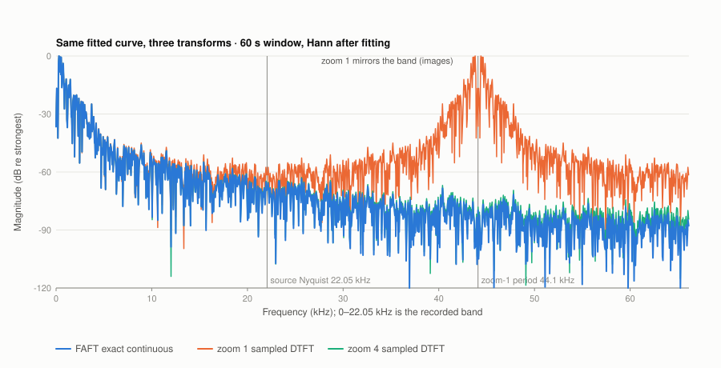
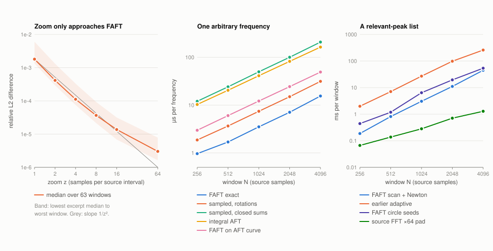
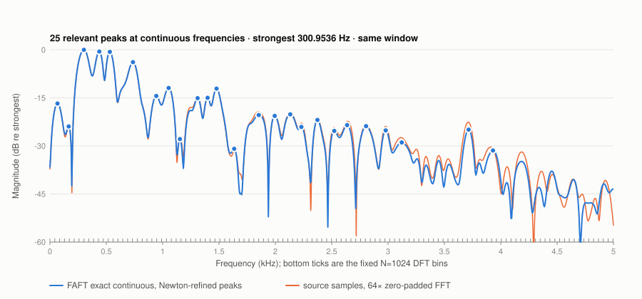

# The Angular Fourier Transform for obtaining a Continuous Spectrum and its fast evaluation

**Riccardo Cecchini** — riccardo.cecchini594@edu.unito.it (and someone else)

*30 September 2026*

---

## Abstract

SinWhisky (2014) predicts unknown samples of a signal by fitting, through every
three consecutive points, the unique circle that contains them. This paper
studies the spectrum of the curve those circles define. Traversed at constant
angular speed, each circular arc is the vertical projection of a rotating vector.
It is therefore a finite segment of a sinusoid with its own centre, radius, phase
and angular rate. We define the **Angular Fourier Transform (AFT)** as the exact
continuous-time Fourier integral of this piecewise-rotational curve. We show that
it has a closed form for every real frequency $\omega$, so its frequency axis is
continuous and not tied to the number of samples. We then present the
**Fast Angular Fourier Transform (FAFT)**, an evaluation scheme based on a
*rotate-and-add* rule that mirrors the Cooley–Tukey butterfly but uses the
circles' own angles instead of roots of unity. It needs no quadrature, no
sampling and no transcendental function per circle. We prove that sampling the
curve more densely ("zoom") only approaches the AFT, differing from it by
spectral images and join terms. We give analytic derivatives for locating
spectral peaks at continuous frequencies, and report measurements on a real
recording. The AFT on 1,024-sample windows is evaluated in 2.4–10.6 µs per
frequency. Its values agree with independent quadrature to $\sim10^{-14}$, and a
converged list of relevant peaks costs 1.4–10.9 ms. We also state what the method
does not provide. It is not faster than an FFT for a complete fixed-bin
spectrum, and the angular rates of individual circles are not physical
frequencies.

---

## 1. Introduction

The Fast Fourier Transform [1] computes $N$ spectral coefficients of $N$ samples
at the fixed frequencies $2\pi k/N$. The sampled data determine this grid. A
frequency between two bins can only be approached by padding or by
interpolation, and the spectrum is that of the *samples*, not of any continuous
waveform behind them.

SinWhisky takes a geometric view of the samples. Given three points, exactly one
circle passes through them. Assigning such a circle to every neighbourhood of the
signal produces a continuous curve through all samples. The original algorithm
used this curve to *zoom*: to synthesize new samples between the known ones [2].

The question addressed here is different. **What is the Fourier transform of
the curve the circles determine, and can it be computed quickly and exactly at
any frequency?** Three ideas used to be confused, and the paper keeps them
apart:

1. **Circle determination.** Fitting circles through source points.
2. **Zoom.** Evaluating the fitted curve at fractional positions. This produces
   samples, not a spectrum.
3. **The Angular Fourier Transform.** The exact integral of the fitted curve
   against $e^{-i\omega t}$.

Section 2 fixes the geometry and Section 3 defines the AFT and derives its closed
form. Section 4 proves the relation between zoom and the AFT. Section 5 presents
the FAFT algorithm and Section 6 the search for relevant frequencies.
Section 7 reports measurements and Section 8 discusses limitations.

---

## 2. Circles determined by samples

### 2.1 The circle through three points

Let $P_j=(x_j,y_j)$, $j=0,1,2$, be three points that are not collinear. The
centre $C=(c_x,c_y)$ of the unique circle through them solves the linear system

$$
\begin{pmatrix} 2(x_1-x_0) & 2(y_1-y_0)\\ 2(x_2-x_1) & 2(y_2-y_1)\end{pmatrix}
\begin{pmatrix} c_x\\ c_y\end{pmatrix}
=
\begin{pmatrix} x_1^2-x_0^2+y_1^2-y_0^2\\ x_2^2-x_1^2+y_2^2-y_1^2\end{pmatrix},
\qquad r=\lVert P_1-C\rVert .
$$

When the determinant vanishes, the points are collinear and the circle degenerates
into its zero-curvature limit, a straight line. This limit is kept explicitly as a
line and is never stored as an infinite radius.

The horizontal coordinate is time scaled by an *aperture* $s>0$. For a support
of $L$ samples starting at sample $a$, with interior point $a+m$, the three
points are

$$
P_0=(0,\,x[a]),\quad P_1=(m s,\,x[a+m]),\quad P_2=(L s,\,x[a+L]).
$$

### 2.2 Equal-angle traversal

Let $\theta_j=\operatorname{atan2}(y_j-c_y,\,x_j-c_x)$, unwrapped in the
direction that visits $P_1$ between $P_0$ and $P_2$. The angular mode of SinWhisky
moves along the circle at constant angular speed on each side of the interior
point. On the first half, $0\le u<m$, and on the second, $0\le u<L-m$:

$$
y(u)=c_y+r\sin(\theta_0+\beta_1 u),\qquad \beta_1=\frac{\theta_1-\theta_0}{m};
\qquad
y(u)=c_y+r\sin(\theta_1+\beta_2 u),\qquad \beta_2=\frac{\theta_2-\theta_1}{L-m}.
$$

Each half is therefore a **rotation**: the vertical projection of a vector of
length $r$ turning at $\beta$ radians per sample around a centre at height $c_y$.

**Definition 1 (rotation).** A rotation is a tuple $(s,L,c,r,\varphi,\beta,d)$
with support $[s,s+L)$, $L\in\mathbb N$, and

$$
y(t)=c+r\sin\bigl(\varphi+\beta\,(t-s)\bigr)+d\,(t-s),\qquad s\le t<s+L.
$$

Arcs have $d=0$; lines have $r=0$.

**Definition 2 (circle curve).** A circle curve on $[0,N)$ is a finite sequence
of rotations whose supports tile $[0,N)$. Rotations with an identical support
are summed ("stacked").

Fitting is accepted only if the curve reproduces every covered source sample
within a stated tolerance. The rate $\beta$ is a *geometric* quantity: it depends
on the aperture $s$ and is not, in general, a frequency of the recorded sound
(see §8).

---

## 3. The Angular Fourier Transform

### 3.1 Definition

**Definition 3 (AFT).** Let $y$ be a circle curve, $[p,q)\subseteq[0,N)$ a
window of duration $T=q-p$, and $w$ a weight on $[p,q)$. The Angular Fourier
Transform of $y$ at a real angular frequency $\omega$ (radians per source
sample) is

$$
\mathcal A[y](\omega)=\int_p^q y(t)\,w(t)\,e^{-i\omega (t-p)}\,dt .
$$

We use $w\equiv1$ (rectangular) or the continuous periodic Hann window
$w(t)=\tfrac12-\tfrac12\cos\bigl(2\pi(t-p)/T\bigr)$. The normalized coefficient
is $\mathcal A/\!\int w$, so a sinusoid of amplitude $A$ has magnitude about $A/2$.

Two properties distinguish $\mathcal A$ from the DFT. First, $\omega$ ranges
over all of $\mathbb R$; there is no grid and no periodicity in $\omega$. Second,
the transform is that of the continuous curve, including its behaviour between
samples.

### 3.2 Closed form

Let

$$
E_k(\delta,L)=\int_0^L u^k e^{i\delta u}\,du,\qquad
E_0(\delta,L)=\frac{e^{i\delta L}-1}{i\delta},\quad
E_k(\delta,L)=\frac{L^k e^{i\delta L}-k\,E_{k-1}(\delta,L)}{i\delta}\ (\delta\ne0),
$$

with $E_k(0,L)=L^{k+1}/(k+1)$. We write a rotation in *anchored* form with
$y_0=y(s)$, $a=r\sin\varphi$ and $b=r\cos\varphi$:

$$
y(s+u)=y_0+a\,(\cos\beta u-1)+b\sin\beta u+d\,u .
$$

**Proposition 1.** For a rectangular window containing the support of one
rotation,

$$
\Phi(\omega)=\int_0^L y(s+u)\,e^{-i\omega u}\,du
= y_0E_0(-\omega)
+a\Bigl[\tfrac12\bigl(E_0(\beta-\omega)+E_0(-\beta-\omega)\bigr)-E_0(-\omega)\Bigr]
+\frac{b}{2i}\bigl[E_0(\beta-\omega)-E_0(-\beta-\omega)\bigr]
+d\,E_1(-\omega),
$$

and for a circle curve,

$$
\mathcal A[y](\omega)=\sum_{\text{rotations}} e^{-i\omega (s-p)}\,\Phi_s(\omega).
$$

*Proof.* Write $\cos\beta u=\tfrac12(e^{i\beta u}+e^{-i\beta u})$ and
$\sin\beta u=\tfrac1{2i}(e^{i\beta u}-e^{-i\beta u})$. Each resulting term is
$\int_0^L u^k e^{i(\pm\beta-\omega)u}du=E_k(\pm\beta-\omega)$. Linearity over
the tiling and the shift $t=s+u$ give the sum. $\square$

The anchored form keeps the start value $y_0$ separate from the deviation. The
large and nearly cancelling terms $c$ and $r$ of flat, large-radius arcs never
appear in the sum.

**Proposition 2 (Hann weighting).** With $\Delta=2\pi/T$ and $\mathcal A_\square$
the rectangular transform,

$$
\mathcal A_{\text{Hann}}(\omega)=\tfrac12\mathcal A_\square(\omega)
-\tfrac14\mathcal A_\square(\omega-\Delta)-\tfrac14\mathcal A_\square(\omega+\Delta).
$$

*Proof.* $-\tfrac12\cos\Delta(t-p)=-\tfrac14\bigl(e^{i\Delta(t-p)}+e^{-i\Delta(t-p)}\bigr)$
shifts the frequency by $\mp\Delta$. $\square$

The window is therefore applied *after* fitting and exactly. No refit and no
sampling occur.

**Proposition 3 (derivatives).** With phase origin at the window centre
$t_c=p+T/2$ and $\sigma=s-t_c$, write $\Psi_k(\omega)=\int_0^L u^k\,y(s+u)\,e^{-i\omega u}du$
(obtained from Proposition 1 with $E_0\to E_k$ and $E_1\to E_{k+1}$). Then

$$
\frac{d}{d\omega}\Bigl[e^{-i\omega\sigma}\Psi_0\Bigr]=-i\,e^{-i\omega\sigma}\bigl(\sigma\Psi_0+\Psi_1\bigr),\qquad
\frac{d^2}{d\omega^2}\Bigl[e^{-i\omega\sigma}\Psi_0\Bigr]=-e^{-i\omega\sigma}\bigl(\sigma^2\Psi_0+2\sigma\Psi_1+\Psi_2\bigr).
$$

Thus $\mathcal A$, $\mathcal A'$ and $\mathcal A''$ are all closed forms of
the same rotations.

---

## 4. Zoom is sampling, not the transform

SinWhisky's zoom evaluates the curve at $z$ points per source interval. The DFT
of those samples, divided by $z$, is often taken as "the spectrum of the
zoomed signal". It is not the AFT.

**Proposition 4.** Let $g(t)=y(t)w(t)$ on $[p,q)$, zero elsewhere, with $w$ the
Hann window. Let $g$ have finitely many value jumps $J_j$ at join points
$t_j$ on the grid, and samples taken from the right. Then

$$
\frac1z\sum_{n}g\!\left(p+\tfrac nz\right)e^{-i\omega n/z}
=\sum_{m\in\mathbb Z}\mathcal A_{\text{Hann}}[y]\bigl(\omega+2\pi z m\bigr)
+\frac1z\sum_j \tfrac12 J_j\,w(t_j)\,e^{-i\omega(t_j-p)} .
$$

*Proof.* The Poisson summation formula for a piecewise smooth, compactly
supported function applies. Its sampled side uses the mid-value
$\tfrac12(g(t^-)+g(t^+))$ at each jump; right-sided sampling adds
$\tfrac12J_j$. $\square$

The zoomed spectrum is therefore the AFT plus **images** at multiples of
$2\pi z$, plus join terms. At $z=1$ the band above the source Nyquist is a
mirror of the audio band (Figure 1). As $z\to\infty$ the images vanish like
$z^{-2}$ (for a curve that is continuous with kinks) and the join terms like
$z^{-1}$. The AFT is the limit, computed directly.



*Figure 1. One fitted window of a Beethoven recording (60 s), Hann applied
after fitting. The exact AFT (blue) against the zoom-1 (orange) and zoom-4 (aqua)
sampled transforms of the same curve, up to three times the source Nyquist.
Zoom 1 mirrors the band around 44.1 kHz; zoom 4 follows the AFT closely in this
range. The AFT has no images.*

---

## 5. The Fast Angular Fourier Transform

### 5.1 The rotate-and-add rule

The Cooley–Tukey FFT combines partial transforms by *multiplying one by a
rotation and adding it to the other*, with rotations drawn from the $N$-th roots
of unity. The FAFT applies the same rule to Proposition 1, with rotations given
by the circles and by an arbitrary real $\omega$.

Let $q=e^{-i\omega}$. For consecutive rotations, $e^{-i\omega s_{k+1}}=e^{-i\omega s_k}q^{L_k}$,
so support phases are *chained* by multiplication. The terms
$e^{i(\pm\beta-\omega)L}$ in $E_0$ factor as

$$
e^{i(\beta-\omega)L}=\underbrace{e^{i\beta L}}_{\text{prepared once}}\;q^{L},
\qquad
e^{i(-\beta-\omega)L}=\overline{e^{i\beta L}}\;q^{L}.
$$

The *turn* $e^{i\beta L}$ belongs to the circle and does not depend on $\omega$.
One query therefore needs a single $\sin/\cos$ pair (for $q$), one power $q^{L}$
per distinct support length, and per rotation only complex products and two
real divisions ($1/(\beta-\omega)$ and $1/(-\beta-\omega)$).

### 5.2 Numerical stability

When $|x|=|\delta L|$ is small (near DC or resonance, $\omega\approx\pm\beta$),
the ratio $(e^{ix}-1)/(i\delta)$ cancels. For $|x|$ below a threshold (0.05 for
values, 0.5 for derivatives), the implementation evaluates

$$
E_k(\delta,L)=L^{k+1}\sum_{n\ge0}\frac{(ix)^n}{n!\,(n+k+1)}
$$

in Horner form in $x^2$ with constant coefficients. Above the threshold, the
ratio and recurrence lose at most about $\varepsilon/|x|^{k+1}$. Phases chained
by multiplication are re-anchored with an exact $\sin/\cos$ every 64 supports.

### 5.3 Algorithms

```text
Algorithm 1  PREPARE(curve, window [p,q), weighting)
  for each rotation (s, L, c, r, φ, β, d) overlapping [p,q):
      crop to [max(s,p), min(s+L,q));   o ← max(s,p) − s
      y0 ← y(s+o);  a ← r·sin(φ+βo);  b ← r·cos(φ+βo)        ▷ anchored form
      turn ← e^{iβL'}                                          ▷ ω-independent
      store (s'−p, L', y0, a, b, β, d, turn)
  lengths ← sorted distinct L'
  return prepared window
```

```text
Algorithm 2  RECT(prepared, ω)                     ▷ Proposition 1, O(R)
  q ← e^{−iω};  Q[L] ← q^L for L in lengths        ▷ one sin/cos, few products
  S ← 0;  phase ← 1
  for each rotation k in time order:
      e_dc ← E0(−ω, L_k; Q[L_k])
      Φ ← y0·e_dc
      if arc:  e₊ ← E0(β−ω; turn·Q[L_k]);   e₋ ← E0(−β−ω; conj(turn)·Q[L_k])
               Φ ← Φ + a·((e₊+e₋)/2 − e_dc) + b·(e₊−e₋)/(2i)
      if d≠0:  Φ ← Φ + d·E1(−ω; Q[L_k], e_dc)
      S ← S + phase·Φ                              ▷ rotate and add
      phase ← phase·Q[L_k]                         ▷ re-anchor every 64 steps
  return S

Algorithm 3  AFT(prepared, ω)
  if rectangular: return RECT(ω)/T
  Δ ← 2π/T
  return (½RECT(ω) − ¼RECT(ω−Δ) − ¼RECT(ω+Δ)) / (T/2)   ▷ Proposition 2
```

**Complexity.** Preparation is $O(R)$ for $R$ rotations in the window. One
frequency costs $O(R)$, independent of how many samples the curve could be zoomed
to. $K$ arbitrary frequencies cost $O(RK)$. For a dense grid with $K\sim N$ and
$R\propto N$, this is quadratic. It is not an alternative to the FFT for
computing all DFT bins of the samples, which is a different quantity.

---

## 6. Relevant frequencies on a continuous axis

The AFT is a smooth function of $\omega$. Its relevant frequencies are the local
maxima of $|\mathcal A|$ above a floor. They form a variable-length list of
real numbers, not $N/2+1$ bins.

The resolution of the transform is set by the window *duration*, $2\pi/T$, not by
the number of samples. A zoomed curve has the same $T$ and therefore the same
resolution. Seeds are taken on a grid of spacing $2\pi/(T\rho)$ with density
$\rho$ (default 2). Each seed is refined by Newton's method on
$g(\omega)=|\mathcal A(\omega)|^2$, using Proposition 3:

$$
g'=2\,\mathrm{Re}\bigl(\overline{\mathcal A}\,\mathcal A'\bigr),\qquad
g''=2\bigl(|\mathcal A'|^2+\mathrm{Re}(\overline{\mathcal A}\,\mathcal A'')\bigr),\qquad
\omega\leftarrow\omega-\frac{g'}{g''}\quad(g''<0).
$$

```text
Algorithm 4  PEAKS(prepared, [ω_lo, ω_hi], ρ, floor)
  scan |AFT| on ω_j = ω_lo + j·2π/(Tρ)          ▷ Hann reuses one RECT grid
  for each local maximum j above floor:
      ω ← parabolic vertex of log|AFT| at j−1, j, j+1
      [lo, hi] ← [ω_{j−1}, ω_{j+1}]
      repeat                                     ▷ safeguarded Newton
          (A, A', A'') ← DERIVATIVES(ω)          ▷ Proposition 3
          g1 ← 2Re(conj(A)A');  g2 ← 2(|A'|² + Re(conj(A)A''))
          if g1 > 0: lo ← ω else hi ← ω
          ω_new ← ω − g1/g2 if g2 < 0 and inside [lo,hi] else (lo+hi)/2
      until |ω_new − ω| < 10⁻¹²
      drop if pinned to a bracket edge (a flank) or not converged
  merge peaks closer than π/(2T), keeping the strongest; apply floors
  return peaks (ω, A(ω))
```

The grouping, merging and exclusion steps are explicit. Nearby candidates are
merged, weak ones are excluded by relative and absolute floors, and flanks and
unconverged seeds are discarded and counted. The scan is a seed heuristic, not a
completeness proof. Finer query precision also does not separate two tones
closer than about $2\pi/T$: an arbitrary query position is not added
resolution.

---

## 7. Experiments

**Setup.** A Beethoven recording (44.1 kHz) was decoded to PCM16 and the channels
averaged to mono. Excerpts of two seconds at 60, 180 and 300 s were used, each
contributing 21 evenly spaced windows of $N=1024$ samples. The circles were
fitted hierarchically on variable supports of at most 128 samples, with every
source sample within 16 PCM16 units. The Hann window was applied after fitting.
Timings are warmed medians on an arm64 laptop, Rust 1.98.1.

**Exactness.** The AFT was compared with an independent Gauss–Legendre quadrature
of the exported rotations; the largest relative difference was $1.8\cdot10^{-14}$.
All 1,219 reported peaks were confirmed as local maxima by the same quadrature.
On the triplet curve of the original angular model, the FAFT matched the
existing numerical-integral implementation to $6.5\cdot10^{-14}$.

**Zoom convergence (Proposition 4).** The median relative $L^2$ difference
between the zoom-$z$ sampled transform and the AFT, below Nyquist, is:

| $z$ | 1 | 2 | 4 | 8 | 16 | 64 |
|---|---:|---:|---:|---:|---:|---:|
| 60 s | $2.1\cdot10^{-3}$ | $4.6\cdot10^{-4}$ | $1.2\cdot10^{-4}$ | $3.9\cdot10^{-5}$ | $1.5\cdot10^{-5}$ | $3.3\cdot10^{-6}$ |
| 180 s | $1.3\cdot10^{-3}$ | $2.9\cdot10^{-4}$ | $7.5\cdot10^{-5}$ | $2.1\cdot10^{-5}$ | $6.9\cdot10^{-6}$ | $1.6\cdot10^{-6}$ |
| 300 s | $1.8\cdot10^{-3}$ | $4.2\cdot10^{-4}$ | $1.1\cdot10^{-4}$ | $3.7\cdot10^{-5}$ | $1.4\cdot10^{-5}$ | $3.0\cdot10^{-6}$ |

The decay is close to $z^{-2}$ at low zoom (images) and approaches $z^{-1}$ at
high zoom (join terms), as Proposition 4 predicts.

**Cost.** Per-window medians at $N=1024$:

| | 60 s | 180 s | 300 s |
|---|---:|---:|---:|
| Rotations per window | 247 | 141 | 546 |
| FAFT, one Hann frequency | 4.17 µs | 2.44 µs | 10.61 µs |
| Sampled-curve kernel, rotations (zoom 1) | 7.99 µs | 5.57 µs | 14.43 µs |
| Sampled-curve kernel, closed sums (zoom 1) | 54.22 µs | 34.31 µs | 95.01 µs |
| Numerical-integral AFT, triplet curve | 41.00 µs | 41.06 µs | 41.12 µs |
| FAFT, same triplet curve | 12.22 µs | 11.91 µs | 12.42 µs |
| FAFT relevant peaks (scan + Newton) | 3.10 ms | 1.42 ms | 10.93 ms |
| Earlier adaptive peak search (sampled curve) | 27.42 ms | 16.91 ms | 49.44 ms |
| FFT of the source samples (plain / 64× padded) | 5.8 / 280 µs | 5.8 / 280 µs | 5.9 / 281 µs |

Query cost grows linearly with the number of rotations; the sizes 256…4096
gave 0.97, 1.69, 3.51, 7.09 and 15.47 µs per frequency (Figure 2).



*Figure 2. Left: difference between zoom-sampled transforms and the AFT. Middle:
cost of one arbitrary frequency against window size. Right: cost of a list of
relevant peaks, with the FFT of the samples as a reference for a different target.*

**Continuous peaks.** The FAFT returned on average 19.2, 13.1 and 25.7 peaks per
window. Every one was also found by the earlier adaptive search, which found
about 5% more. Those extra peaks are weak maxima next to stronger ones and are
missed by the density-2 scan; density 4 recovers most of them. Of the peaks of
the 64×-padded FFT of the source samples, 89–94% were recovered, with a median
distance of 0.18–0.44 Hz. The bin spacing is 43 Hz; the reported AFT peaks are
converged to $10^{-12}$ rad/sample on the continuous axis (Figure 3).



*Figure 3. The AFT of one window (blue) with its Newton-refined peaks, against the
64×-padded FFT of the source samples (orange). The ticks at the bottom are the
fixed $N=1024$ DFT bins; the AFT peaks fall between them.*

---

## 8. Discussion and limitations

**Circle rates are not the spectrum.** A natural hope is that the rates $\beta$ of
the circles are themselves the frequencies of the sound, so that grouping them
would yield the spectrum without any transform. The measurements do not support
this. The rates depend on the aperture used to fit the circles. On a synthetic
test they clustered well below the true tone. Seeding the peak search from grouped
rates recovered only 41–43% of the peaks and was slower than the scan. The
continuous frequencies are obtained from the transform of the circles, through
the interference of all rotations, not from the rate of any single one.

**Speed.** One exact continuous query is cheaper than the earlier sampled kernels
and 3.3–3.5× cheaper than numerical integration of the same curve. A complete,
fixed-bin spectrum of the *samples* remains much faster with an FFT. The AFT's
advantage is exactness and freedom of the frequency axis, not asymptotic
complexity.

**Model.** The AFT is the transform of the fitted curve. The fit is exact
within tolerance at the samples only. Content between samples and above the
source Nyquist is produced by the circles, not recovered information. Rounded
circles leave small value jumps at joins; they cause the $z^{-1}$ tail of
Proposition 4.

**Future work.** Future directions include:

- Rotate-and-add in time: sliding windows that update only the rotations
  entering and leaving.
- Circle fits with continuous joins.
- Certified bounds for peak completeness.
- Circle determinations whose angular rates carry physical frequency.

---

## 9. Conclusion

The circles that SinWhisky determines through samples define a continuous curve
made of rotations. Its Fourier transform, the Angular Fourier Transform, has an
exact closed form at every real frequency. The Fast Angular Fourier Transform
evaluates it by rotating and adding the circles' own contributions, with no
quadrature, no sampling and no transcendental work per circle. Zoom is not
a route to this spectrum. It adds images that the AFT does not contain.
Combined with analytic derivatives, the FAFT yields relevant frequencies on a
continuous axis, measured to be exact and substantially faster than earlier
search approaches. It is not claimed to replace the FFT.

---

## References

1. J. W. Cooley and J. W. Tukey, "An algorithm for the machine calculation of
   complex Fourier series," *Mathematics of Computation* 19 (1965) 297–301.
2. R. Cecchini, *SinWhisky e FLT* (2014), [docs/SinWhisky e FLT.pdf](<SinWhisky e FLT.pdf>).
3. J. O. Smith III, *Mathematics of the Discrete Fourier Transform*, CCRMA,
   Stanford (online edition).
4. F. J. Harris, "On the use of windows for harmonic analysis with the discrete
   Fourier transform," *Proceedings of the IEEE* 66 (1978) 51–83.

**Reproducibility.** The implementation is in [src/faft.rs](../src/faft.rs), and the
tests (independent quadrature, Proposition 4, derivatives, same-curve agreement)
are in [tests/faft.rs](../tests/faft.rs). The measurements come from
[tools/faft_compare.py](../tools/faft_compare.py) and are recorded in
[experiments/faft-circle-arcs-beethoven-20260930.json](experiments/faft-circle-arcs-beethoven-20260930.json).
Engineering details are in [FAFT.md](FAFT.md).
