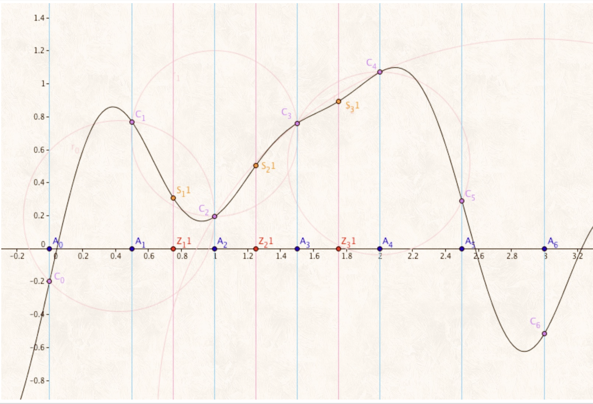
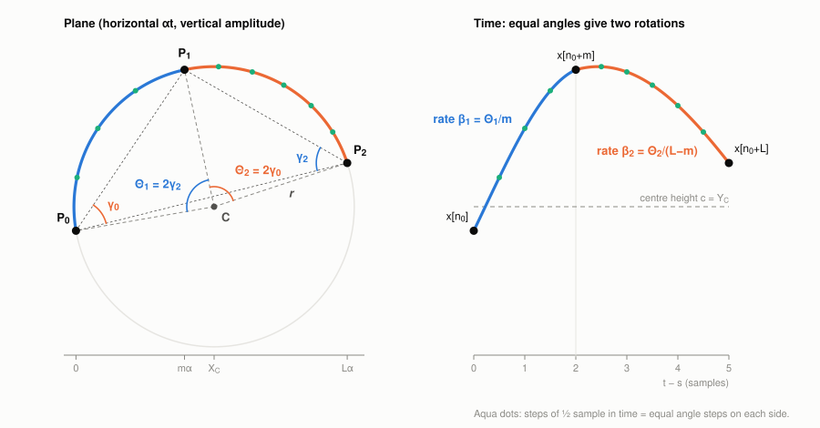

# The Angular Fourier Transform for Obtaining a Continuous Spectrum

**Riccardo Cecchini** — riccardo.cecchini594@edu.unito.it

*30 September 2026*

---

## Abstract

A sampled signal can be extended to a continuous geometric model by fitting a circle through local groups of samples and traversing each accepted arc at constant angular speed. Each arc is then the vertical projection of a rotating radius vector, that is, a finite sinusoidal segment with its own centre, radius, phase and angular rate. This paper studies the spectrum of that explicitly constructed continuous curve, rather than the spectrum of the source samples alone. Starting from the circle through three points, every parameter of a rotation is derived from elementary geometry: the angular sweeps of the two sides of a circle are twice the inscribed angles of the triangle formed by the three points, and a straight line is the limit of infinite radius. We define the **Angular Fourier Transform (AFT)** as the exact Fourier integral of the piecewise-rotational model. Integrating the rotating radius vector gives a closed form for each arc, which depends only on the centre height, the angular rate and the arc's endpoint values and slopes; the time distance between arcs enters only as a phase, by the shift theorem. The transform is therefore available at every real angular frequency $\omega$, and the query frequency is not tied to the number of source samples. We then present the **Fast Angular Fourier Transform (FAFT)**, which evaluates the closed form by chaining these phases with complex multiplications (*rotate and add*). FAFT is a single-frequency recurrence, closer to Goertzel's algorithm than to the Cooley–Tukey FFT: it shares no work between frequencies, and because the fitted curve is a nonlinear function of the samples, no factorization of the discrete Fourier transform applies. It needs no numerical quadrature, no dense resampling and no transcendental function per rotation. We prove that densely sampling the fitted curve ("zoom") only approaches the AFT and differs from it by spectral images and join terms, whose decay follows from the endpoint form. We also derive analytic frequency derivatives for locating spectral peaks directly on the continuous frequency axis. On 1,024-sample windows of a real recording, one Hann-weighted AFT query costs 2.4–10.6 µs, agrees with independent quadrature to approximately $10^{-14}$ relative error, and yields a converged list of relevant peaks in 1.4–10.9 ms. The method is not claimed to replace the FFT for a complete fixed-bin spectrum. The angular rates of individual arcs are not physical signal frequencies: they depend on the horizontal scale used for fitting, and the frequencies of the signal emerge only from the interference of all arcs.



*The SinWhisky construction [1]: the circle through three consecutive samples ($C_j$, at the instants $A_j$) supplies values ($S$) at new positions ($Z$) between the samples.*

---

## 1. Introduction

The $N$-point discrete Fourier transform (DFT), and the fast Fourier transform (FFT) algorithms that compute it, return $N$ coefficients of $N$ samples on the frequency grid $2\pi k/N$, where $k$ is an integer bin index [2, 3]. Values of the discrete-time Fourier transform can also be evaluated away from those bins, by zero-padding, by direct summation or by a single-frequency recurrence such as Goertzel's algorithm [4], but all of these describe the sampled sequence. They do not define what the signal does between samples.

This paper starts from an explicit continuous model instead. Local source samples are embedded as points in a plane whose horizontal axis is scaled sample time and whose vertical axis is amplitude. Three non-collinear points determine a unique circle. The arc between them is traversed at constant angular speed, so interpolation is uniform in **angle**, not in the horizontal coordinate. Collinear points are represented by the straight-line limit. Repeating this construction over accepted supports gives a piecewise-rotational curve that passes through, or stays within a declared tolerance of, the source samples.

The transform problem is then precise: **what is the Fourier transform of this continuous piecewise-rotational curve, and can it be evaluated quickly and exactly at an arbitrary real frequency?** Three operations must be kept separate:

1. **Geometric fitting.** Determine circles or line limits from source samples (Section 2).
2. **Dense evaluation (zoom).** Sample the fitted curve at fractional source positions. This produces a denser discrete sequence, not a transform (Section 4).
3. **Angular Fourier Transform.** Integrate the fitted continuous curve directly against $e^{-i\omega t}$ (Section 3) and evaluate that integral with FAFT (Section 5).

The derivation proceeds from geometry to spectrum. Section 2 derives the circle, its angles and its angular rates from the three anchor points, shows that each half-arc is a rotating radius vector, obtains the line as the limit of infinite radius, and explains why the rates are not frequencies of the signal. Section 3 integrates one rotation in closed form, gives an equivalent form that depends only on the arc's endpoints, and assembles the transform of the whole curve with the shift theorem. Section 4 relates dense evaluation to the AFT. Section 5 presents the FAFT algorithm and Section 6 the search for relevant frequencies. Section 7 reports measurements and Section 8 discusses limitations.

### 1.1 What the AFT is not

The AFT and the DFT answer different questions, and FAFT is not a variant of the FFT. The differences are summarized below and justified in Remark 1 and Section 5.1.

| | DFT, computed by an FFT | AFT, evaluated by FAFT |
|---|---|---|
| Input | $N$ samples $x[n]$ | A fitted continuous curve $y(t)$ made of $R$ rotations |
| Transformed object | The sampled sequence | The curve, including its values between samples |
| Frequency axis | $N$ bins $2\pi k/N$; periodic in $\omega$ with period $2\pi$ | Any real $\omega$; not periodic |
| Dependence on the samples | Linear | Nonlinear: the circles are nonlinear functions of the samples |
| Source of speed | A factorization of the DFT matrix shares partial sums among all $N$ bins: $O(N\log N)$ in total | Closed forms and chained phases at one frequency: $O(R)$ per frequency, nothing shared between frequencies |
| Frequency resolution | About $2\pi/N$, equal to the bin spacing | About $2\pi/T$ for a window of duration $T$; finer queries add no resolution |

### 1.2 Notation

| Symbol | Meaning | Unit |
|---|---|---|
| $N$ | Number of source samples | — |
| $x[n]$ | Source sample at integer index $n$ | amplitude |
| $t$ | Continuous time | source-sample intervals ("samples") |
| $i$ | Imaginary unit, $i^2=-1$ | — |
| $\omega$ | Query angular frequency; $\omega F_s/(2\pi)$ hertz at sampling rate $F_s$ | rad/sample |
| $q$ | $e^{-i\omega}$, the phase advance per source interval | — |
| $\alpha$ | Aperture: horizontal plane units per source interval | amplitude/sample |
| $P_j=(X_j,Y_j)$ | Anchor points in the plane, $j=0,1,2$ | amplitude |
| $C=(X_C,Y_C)$, $r$ | Circle centre and radius | amplitude |
| $D$, $\mathcal S$ | Determinant of the centre equations; signed area of the triangle $P_0P_1P_2$ | amplitude² |
| $\theta_j$, $\gamma_j$ | Angle of the radius from $C$ to $P_j$; interior angle of the triangle at $P_j$ | rad |
| $\Theta_1$, $\Theta_2$ | Signed angular sweeps of the two sides of a circle | rad |
| $s$, $L$ | Start and duration of a rotation's support $[s,s+L)$ | samples |
| $c$, $\varphi$, $\beta$, $d$ | Centre height, start angle, angular rate and linear slope of a rotation | amplitude, rad, rad/sample, amplitude/sample |
| $\zeta(u)$ | Complex radius vector at local time $u$ | amplitude |
| $a$, $b$ | Vertical and horizontal components of the start radius vector, $\zeta(0)=b+ia$ | amplitude |
| $[t_0,t_0+T)$ | Transform window with start $t_0$ and duration $T$ | samples |
| $w(t)$, $W$ | Window weight and its integral | —, samples |
| $E_\ell(\delta,L)$ | Exponential moment of order $\ell$ at frequency offset $\delta$ | samples$^{\ell+1}$ |
| $\Phi(\omega)$ | Transform of one rotation, with phase origin at its start | amplitude·samples |
| $\mathcal A[y] (\omega)$ | AFT of the curve $y$ | amplitude·samples |
| $R$, $K$ | Number of rotations in the window; number of queried frequencies | — |

Both plane coordinates are in amplitude units, because the horizontal coordinate is a sample offset multiplied by $\alpha$. Overlines denote complex conjugation, primes on $y$ denote derivatives with respect to time, and primes on $\mathcal A$ derivatives with respect to $\omega$.

---

## 2. Geometric signal model

### 2.1 Plane embedding and aperture

A support is a range of source samples from $n_0$ to $n_0+L$, with integer start $n_0$, integer length $L\ge2$, and an interior anchor offset $m$ with $0 < m < L$. Its three anchor points are placed in a plane whose horizontal coordinate is the sample offset multiplied by a positive *aperture* $\alpha$:

$$
P_0=\bigl(0,\ x[n_0]\bigr),\qquad P_1=\bigl(m\alpha,\ x[n_0+m]\bigr),\qquad P_2=\bigl(L\alpha,\ x[n_0+L]\bigr). \tag{1}
$$

The aperture sets the relative scale of the two axes. A circle is not preserved by unequal scaling of the axes, so $\alpha$ changes the fitted circle, its curvature and its angular rates (Section 2.6). For the elementary triplet construction ($L=2$, $m=1$), a data-adaptive choice is the largest amplitude difference of the three anchors,

$$
\alpha_{\mathrm{triplet}}=\max\bigl(\lvert Y_0-Y_1\rvert,\ \lvert Y_1-Y_2\rvert,\ \lvert Y_0-Y_2\rvert\bigr), \tag{2}
$$

replaced by $1$ for a constant triplet. We call (2) the *range aperture*. The hierarchical fitter of Section 7 uses $\alpha=2g\alpha_{\mathrm{range}}/L$, where $\alpha_{\mathrm{range}}$ is the same largest difference of the three anchors and $g\in\lbrace 1/2,1,2\rbrace$ is a searched gain. The transform derived in Section 3 does not depend on how $\alpha$ was chosen: it uses only the resulting arc parameters.

### 2.2 The circle through three points

A point $C$ is equidistant from $P_0$ and $P_1$ if and only if $\lVert P_1-C\rVert^2=\lVert P_0-C\rVert^2$. Expanding both squares, the quadratic terms in $C$ cancel and leave the linear equation $2(P_1-P_0)\cdot C=\lVert P_1\rVert^2-\lVert P_0\rVert^2$, the perpendicular bisector of the chord $P_0P_1$. The centre $C=(X_C,Y_C)$ is the intersection of this bisector with that of the chord $P_1P_2$:

$$
2(X_1-X_0)X_C+2(Y_1-Y_0)Y_C=X_1^2-X_0^2+Y_1^2-Y_0^2, \tag{3a}
$$

$$
2(X_2-X_1)X_C+2(Y_2-Y_1)Y_C=X_2^2-X_1^2+Y_2^2-Y_1^2. \tag{3b}
$$

Write $B_1$ and $B_2$ for the right-hand sides of (3a) and (3b). The determinant of the system is

$$
D=4\bigl[(X_1-X_0)(Y_2-Y_1)-(Y_1-Y_0)(X_2-X_1)\bigr]=8\mathcal S, \tag{4}
$$

where $\mathcal S$ is the signed area of the triangle $P_0P_1P_2$, positive when its vertices are in counter-clockwise order. By Cramer's rule,

$$
X_C=\frac{2(Y_2-Y_1)B_1-2(Y_1-Y_0)B_2}{D},\qquad Y_C=\frac{2(X_1-X_0)B_2-2(X_2-X_1)B_1}{D},\qquad r=\lVert P_1-C\rVert. \tag{5}
$$

$D=0$ exactly when the three points are collinear. The circle then degenerates into its zero-curvature limit, a straight line, which is kept explicitly (Section 2.5) and never stored as an infinite radius. In floating point the line limit is used when $\lvert D\rvert$ falls below a declared tolerance.

The radius also follows from the triangle alone. With $\gamma_j$ the interior angle at $P_j$, the law of sines gives [5]

$$
r=\frac{\lVert P_2-P_0\rVert}{2\sin\gamma_1}=\frac{\lVert P_1-P_0\rVert}{2\sin\gamma_2}=\frac{\lVert P_2-P_1\rVert}{2\sin\gamma_0}. \tag{6}
$$

A nearly flat triangle, with $\gamma_1$ close to $\pi$, therefore has a large radius.

### 2.3 Angles, direction and angular sweeps

Let $\theta_j=\operatorname{atan2}(Y_j-Y_C,\ X_j-X_C)$ be the angle of the radius from $C$ to $P_j$, so that

$$
P_j=C+r\bigl(\cos\theta_j,\ \sin\theta_j\bigr). \tag{7}
$$

The angles are unwrapped in the direction that visits $P_1$ between $P_0$ and $P_2$. This direction is counter-clockwise when $D>0$ and clockwise when $D < 0$. With time increasing to the right, $D < 0$ means that $P_1$ lies above the chord $P_0P_2$ (locally concave samples), and $D>0$ that it lies below. The arc traversed from $P_0$ to $P_1$ is the one that does not contain $P_2$. By the inscribed angle theorem [5], its central angle is twice the angle $\gamma_2$ that the chord $P_0P_1$ subtends at $P_2$. The same argument applies to the second arc and $\gamma_0$. The signed angular sweeps of the two sides are therefore

$$
\Theta_1=\theta_1-\theta_0=2\gamma_2\operatorname{sgn}D,\qquad \Theta_2=\theta_2-\theta_1=2\gamma_0\operatorname{sgn}D,\qquad \Theta_1+\Theta_2=2(\pi-\gamma_1)\operatorname{sgn}D. \tag{8}
$$

Each sweep has magnitude between $0$ and $2\pi$, and so does their sum: the curve never makes a full turn. As the triangle flattens, $\gamma_1\to\pi$ and both sweeps tend to zero.

### 2.4 Equal-angle traversal: each half-arc is a rotation

The defining interpolation rule is **equal-angle traversal**: on each side of the interior anchor, the angle changes linearly with time. Let $u$ be time measured from the start of a side, with $0\le u < m$ on the first side and $0\le u < L-m$ on the second. The angle is

$$
\theta(u)=\theta_0+\beta_1u,\quad \beta_1=\frac{\Theta_1}{m}=\frac{2\gamma_2\operatorname{sgn}D}{m};\qquad\qquad \theta(u)=\theta_1+\beta_2u,\quad \beta_2=\frac{\Theta_2}{L-m}=\frac{2\gamma_0\operatorname{sgn}D}{L-m}. \tag{9}
$$

The angular rates $\beta_1$ and $\beta_2$, in radians per source sample, are therefore the inscribed angles of the anchor triangle, doubled and divided by the durations of the sides. The moving point visits $P_0$, $P_1$ and $P_2$ at times $0$, $m$ and $L$ of the support (Figure 1).

Identify the plane with the complex plane, the point $(X,Y)$ with the number $X+iY$. The moving point is the centre plus a rotating radius vector $\zeta$:

$$
X(u)+iY(u)=X_C+iY_C+\zeta(u),\qquad \zeta(u)=re^{i\theta(u)}=\zeta(0)e^{i\beta u}. \tag{10}
$$

The interpolated amplitude is its imaginary part, the vertical projection of the rotating radius vector:

$$
y(u)=Y_C+r\sin\theta(u)=Y_C+\frac{\zeta(0)e^{i\beta u}-\overline{\zeta(0)}e^{-i\beta u}}{2i}. \tag{11}
$$

Equal increments of $u$ correspond to equal angular increments, hence to equal arc lengths $r\lvert\beta\rvert$ per sample. This is not the curve obtained by evaluating the circle at uniformly spaced horizontal coordinates: the horizontal coordinate of the moving point, $X(u)=X_C+r\cos\theta(u)$, is not proportional to time. The horizontal centre $X_C$ and the aperture $\alpha$ influence the curve only through the angles $\theta_j$. Once the angles are known, $y$ depends on $Y_C$, $r$, $\theta_0$ and $\beta$ alone.

The time derivative is the rate times the horizontal component of the radius vector:

$$
y'(u)=r\beta\cos\theta(u)=\beta\bigl(X(u)-X_C\bigr). \tag{12}
$$

At the interior anchor the angle is continuous but the rate changes from $\beta_1$ to $\beta_2$. The curve is therefore continuous at $P_1$, and its slope jumps by $r\cos\theta_1(\beta_2-\beta_1)$ unless $\beta_1=\beta_2$ or $P_1$ is the highest or lowest point of the circle ($\cos\theta_1=0$).



*Figure 1. From three anchor points to two rotations. Left: in the plane, the circle through $P_0$, $P_1$, $P_2$; the central angles $\Theta_1$ and $\Theta_2$ are twice the inscribed angles $\gamma_2$ and $\gamma_0$, as in (8). Right: traversing the same arc at constant angular speed on each side gives two sinusoidal pieces around the centre height $c=Y_C$, with rates $\beta_1=\Theta_1/m$ and $\beta_2=\Theta_2/(L-m)$; the slope changes at $P_1$. Aqua dots mark half-sample time steps, which are equal angle steps on each side. Example: $L=5$, $m=2$, $\alpha=0.32$, anchor amplitudes $0.05$, $1.0$, $0.45$; the triangle is clockwise ($D < 0$), so both rates are negative ($-0.765$ and $-0.489$ rad/sample).*

**Definition 1 (rotation).** A rotation is a tuple $(s,L,c,r,\varphi,\beta,d)$: support $[s,s+L)$ with start $s$ and duration $L>0$ in samples, centre height $c$, radius $r\ge0$, start angle $\varphi$, angular rate $\beta$ and linear slope $d$. At position $t$ its amplitude is

$$
y(t)=c+r\sin\bigl(\varphi+\beta(t-s)\bigr)+d(t-s),\qquad s\le t < s+L. \tag{13}
$$

A half-arc has $c=Y_C$, $\varphi=\theta_0$ or $\theta_1$, $\beta=\beta_1$ or $\beta_2$, and $d=0$; a straight piece has $r=0$. Each circle therefore yields two rotations that share $c$ and $r$ and meet at $P_1$.

**Anchored form.** Expanding $\sin(\varphi+\beta u)$ and writing $y_0=y(s)=c+a$ for the start value gives

$$
y(s+u)=y_0+a(\cos\beta u-1)+b\sin\beta u+du,\qquad a=r\sin\varphi,\quad b=r\cos\varphi. \tag{14}
$$

Geometrically, $b+ia=\zeta(0)$: $a$ is the height of the start point above the centre and $b$ its horizontal offset from the centre. The anchored form starts from the actual start value and adds deviations that vanish at $u=0$, so a flat arc, whose centre lies far away, is evaluated without forming its centre height $c$ (Section 5.3).

### 2.5 The straight line as the limit of infinite radius

Let a rotation's radius grow while its start value $y_0$, its start slope $y'(0)=d$ and its start angle $\varphi$, with $\cos\varphi\ne0$, stay fixed. By (12), $d=\beta b=\beta r\cos\varphi$, so the rate $\beta=d/(r\cos\varphi)$ tends to zero like $1/r$. In (14), $a\beta^2=d^2\sin\varphi/(r\cos^2\varphi)$ and $b\beta=d$, so

$$
a(\cos\beta u-1)=-\tfrac12a\beta^2u^2+O\bigl(a\beta^4u^4\bigr)\to0,\qquad b\sin\beta u=b\beta u+O\bigl(b\beta^3u^3\bigr)\to du, \tag{15}
$$

and the rotation tends to the line $y_0+du$, with an error of order $1/r$. A straight piece is therefore exactly the infinite-radius limit of a rotation, and each formula for arcs in Section 3 tends to the corresponding formula for lines. The implementation stores this limit as $r=0$ with a finite slope $d$, which keeps the line exact and avoids infinite or nearly cancelling parameters.

### 2.6 Why angular rates are not signal frequencies

By (9) the rates are geometric: they are fixed by the shape of the anchor triangle in the plane, and that shape depends on the aperture. A sinusoid makes this exact. Let three consecutive samples be centred on a crest of $A\cos(\omega_0t)$, so that $Y_0=Y_2=A\cos\omega_0$ and $Y_1=A$, placed at $X=0$, $\alpha$ and $2\alpha$. With the drop $h=A(1-\cos\omega_0)$, the triangle is isosceles with $\tan\gamma_0=\tan\gamma_2=h/\alpha$, it is clockwise, and (9) gives

$$
\beta_1=\beta_2=-2\arctan\frac{h}{\alpha}. \tag{16}
$$

The rate matches the frequency of the sinusoid, $\lvert\beta\rvert=\omega_0$, only for the aperture $\alpha=h\cot(\omega_0/2)=A\sin\omega_0$, which is the largest magnitude of the central difference $(x[n+1]-x[n-1])/2$ of the sampled sinusoid. With the range aperture (2), $\alpha=h$ and every symmetric crest is traversed at exactly $-\pi/2$ rad/sample, whatever $\omega_0$. With $\alpha=1$, $A=1000$ and $\omega_0=0.05$, the rate is $-1.79$ rad/sample, about 36 times the frequency of the tone. Angular rates describe local shape in the fitting plane. The frequencies of the signal emerge from the transform of the whole curve, through the interference of all rotations (Remark 2).

### 2.7 From local fits to a circle curve

**Definition 2 (circle curve).** A circle curve on $[0,N)$ is a finite sequence of rotations, in time order, whose supports tile $[0,N)$. Rotations with an identical support may be summed ("stacked").

Two constructions are used in this paper.

*Hierarchical curve.* The fitter of Section 7 chooses variable integer supports, interior anchors and apertures. It keeps a circle only if the two rotations it yields reproduce every covered source sample within a declared tolerance, and otherwise splits the support or uses a line. Consecutive supports share their boundary sample, so the curve is continuous up to the rounding of the stored circle parameters, which leaves small, tolerance-bounded value jumps at joins.

*Triplet curve.* For validation against the original construction, each unit interval $[n,n+1)$ uses the two circles that contain it: the circle through samples $n-1$, $n$, $n+1$ (its second side) and the circle through $n$, $n+1$, $n+2$ (its first side), each fitted with the range aperture (2). The curve on the interval is the equal-weight average of the two sides, that is, two stacked rotations with halved centre heights and radii. A side whose endpoints miss the samples by more than a small relative tolerance is replaced by the line through the two samples, and the frame is closed periodically, from the last sample back to the first.

The triplet curve differs from the dense resampler of the original SinWhisky [1], which blends overlapping equal-angle predictions with a sine weight: with $z$ output positions per source interval, a triplet yields $2z+1$ local values $j=0,\ldots,2z$, weighted by $w_j=\sin\bigl(\pi(j+1)/(2z+2)\bigr)$ and normalized by the accumulated weight. The transform below takes any circle curve as input and depends on neither blending rule.

---

## 3. The Angular Fourier Transform

### 3.1 Definition

**Definition 3 (AFT).** Let $y$ be a circle curve, $[t_0,t_0+T)\subseteq[0,N)$ a window with start $t_0$ and duration $T>0$, and $w$ a real weight on the window. The Angular Fourier Transform of $y$ at a real angular frequency $\omega$ is the complex number

$$
\mathcal A[y] (\omega)=\int_{t_0}^{t_0+T}y(t)w(t)e^{-i\omega(t-t_0)}dt. \tag{17}
$$

The phase origin is the window start $t_0$. We use the rectangular weight $w\equiv1$ or the continuous periodic Hann weight $w(t)=\tfrac12-\tfrac12\cos\bigl(2\pi(t-t_0)/T\bigr)$ [6]. The normalized coefficient is $\mathcal A[y] (\omega)/W$, with $W=\int_{t_0}^{t_0+T}w(t)dt$ equal to $T$ for the rectangular weight and $T/2$ for Hann; a sinusoid of amplitude $A$ then has a normalized magnitude close to $A/2$ at its frequency.

Two properties distinguish $\mathcal A$ from the DFT. First, $\omega$ ranges over all real numbers: there is no frequency grid and no periodicity in $\omega$. Second, the transform is that of the continuous curve, including its behaviour between samples and its content above the source Nyquist frequency $\omega=\pi$, which is produced by the model rather than recorded.

**Remark 1 (linearity).** $\mathcal A$ is linear in the curve $y$, but the curve is a nonlinear function of the samples: the centre (5) is a rational function of the anchor coordinates, and the range aperture (2) itself depends on the samples. The map from samples to $\mathcal A$ is therefore not linear. It has no convolution theorem and cannot be computed as a DFT of the samples followed by a fixed spectral filter. The all-line model is the exception that shows what circles change: if every piece is the line through two consecutive samples of a periodic frame, the curve is the convolution of the samples with a triangular kernel and, at the DFT frequencies, $\mathcal A(2\pi k/N)=\operatorname{sinc}^2(\pi k/N)X[k]$, with $X[k]$ the DFT of the samples and $\operatorname{sinc}v=\sin v/v$ [7]. Circles replace that fixed kernel with shapes that depend on the data.

### 3.2 Exponential moments

For a support of duration $L$, a real frequency offset $\delta$ and an integer order $\ell\ge0$, define the exponential moment

$$
E_\ell(\delta,L)=\int_0^Lu^\ell e^{i\delta u}du. \tag{18}
$$

For $\delta\ne0$, direct integration and integration by parts give

$$
E_0(\delta,L)=\frac{e^{i\delta L}-1}{i\delta},\qquad E_\ell(\delta,L)=\frac{L^\ell e^{i\delta L}-\ell E_{\ell-1}(\delta,L)}{i\delta}\quad(\ell\ge1), \tag{19}
$$

and $E_\ell(0,L)=L^{\ell+1}/(\ell+1)$. Each $E_\ell(\cdot,L)$ is an entire function of $\delta$; the singularity of (19) at $\delta=0$ is removable, and Section 5.3 evaluates the moments by a power series near it. Every closed form below combines these moments at the offsets $-\omega$ and $\pm\beta-\omega$. Where the duration is clear, $E_\ell(\delta)$ abbreviates $E_\ell(\delta,L)$.

### 3.3 Transform of one rotation

Fix one rotation and measure time from its start, $t=s+u$. Its local transform, with phase origin at $s$, is

$$
\Phi(\omega)=\int_0^Ly(s+u)e^{-i\omega u}du. \tag{20}
$$

**Proposition 1 (phasor form).** For a rotation $(s,L,c,r,\varphi,\beta,d)$ with start radius vector $\zeta_0=re^{i\varphi}$,

$$
\Phi(\omega)=cE_0(-\omega)+\frac{\zeta_0E_0(\beta-\omega)-\overline{\zeta_0}E_0(-\beta-\omega)}{2i}+dE_1(-\omega). \tag{21}
$$

*Proof.* Insert (11) and the slope term of (13) into (20). The centre contributes $c\int_0^Le^{-i\omega u}du=cE_0(-\omega)$. The radius vector rotating at $+\beta$ contributes $\zeta_0\int_0^Le^{i(\beta-\omega)u}du=\zeta_0E_0(\beta-\omega)$, and its conjugate, rotating at $-\beta$, contributes $\overline{\zeta_0}E_0(-\beta-\omega)$. The slope contributes $d\int_0^Lue^{-i\omega u}du=dE_1(-\omega)$. $\square$

This decomposition is the geometric content of the transform. A rotation is a constant, its centre height, plus two counter-rotating phasors of length $r/2$, and each phasor resonates where the query frequency matches its own rate, at $\omega=\beta$ and at $\omega=-\beta$. On a finite support a resonance has the finite height $rL/2$ and a main lobe of half-width $2\pi/L$.

**Corollary 1 (anchored form).** With $y_0=c+a$, $a=r\sin\varphi$ and $b=r\cos\varphi$ as in (14), (21) equals

$$
\Phi(\omega)=y_0E_0(-\omega)+a\Bigl[\tfrac12\bigl(E_0(\beta-\omega)+E_0(-\beta-\omega)\bigr)-E_0(-\omega)\Bigr]+\frac{b}{2i}\bigl[E_0(\beta-\omega)-E_0(-\beta-\omega)\bigr]+dE_1(-\omega). \tag{22}
$$

*Proof.* Substitute $c=y_0-a$ and $\zeta_0=b+ia$ in (21) and collect the terms in $a$ and $b$. $\square$

The two bracketed combinations in (22) are the transforms of $\cos\beta u-1$ and $\sin\beta u$. Forms (21) and (22) are equal in exact arithmetic; FAFT evaluates (22), which matches the anchored evaluation (14) of the fitted curve (Section 5.3).

**Corollary 2 (line).** For a straight piece ($r=0$), $\Phi(\omega)=y_0E_0(-\omega)+dE_1(-\omega)$. This is also the limit of (22) along the infinite-radius limit of Section 2.5. Since $\partial E_0(\delta)/\partial\delta=iE_1(\delta)$, the $b$ term tends to $b\beta E_1(-\omega)\to dE_1(-\omega)$, and the $a$ term is $O(a\beta^2)\to0$. $\square$

### 3.4 The endpoint form

A rotation with $d=0$ satisfies, by (13),

$$
y''(u)=-\beta^2\bigl(y(u)-c\bigr), \tag{23}
$$

the equation of a harmonic oscillator of angular frequency $\beta$ centred at height $c$. Integrating (20) by parts twice turns this equation into a statement about the endpoints of the support only.

**Proposition 2 (endpoint form).** For an arc ($d=0$) and $\omega^2\ne\beta^2$, let $y_0$, $y'_0$ be the value and slope at the start of the support and $y_L$, $y'_L$ their left limits at its end. Then

$$
\Phi(\omega)=\frac{\bigl(y'_Le^{-i\omega L}-y'_0\bigr)+i\omega\bigl(y_Le^{-i\omega L}-y_0\bigr)-\beta^2cE_0(-\omega)}{\omega^2-\beta^2}. \tag{24}
$$

*Proof.* Two integrations by parts give $\int_0^Ly''(u)e^{-i\omega u}du=\bigl[y'(u)e^{-i\omega u}\bigr]_0^L+i\omega\bigl[y(u)e^{-i\omega u}\bigr]_0^L-\omega^2\Phi(\omega)$. By (23) the left side equals $-\beta^2\Phi(\omega)+\beta^2cE_0(-\omega)$. Solve for $\Phi(\omega)$. $\square$

By (12) the slopes are $y'=\beta(X-X_C)$, so (24) depends on the circle only through the centre height $c$, the rate $\beta$, and the heights and horizontal offsets of the two endpoints, that is, through the radius vectors $\zeta_0$ and $\zeta_L=\zeta_0e^{i\beta L}$ at the ends of the arc. In terms of these vectors, (21) reads

$$
\Phi(\omega)=cE_0(-\omega)-\frac12\Bigl[\frac{\zeta_Le^{-i\omega L}-\zeta_0}{\beta-\omega}+\frac{\overline{\zeta_L}e^{-i\omega L}-\overline{\zeta_0}}{\beta+\omega}\Bigr], \tag{25}
$$

because $\zeta_0e^{i(\beta-\omega)L}=\zeta_Le^{-i\omega L}$. In words: the spectrum of an arc is generated at its two ends, and everything between them is summarized by the centre height and the angular rate. The resonances at $\omega=\pm\beta$ are removable singularities of (24) and (25), where numerator and denominator vanish together; their values are the finite limits given by (21). A line satisfies (23) with $\beta=0$, and (24) with $\beta=0$ gives its transform for $\omega\ne0$, so the endpoint form covers every piece of a circle curve.

**Corollary 3 (decay at high frequency).** As $\lvert\omega\rvert$ grows beyond all rates, the rectangular AFT of a circle curve satisfies

$$
\mathcal A_{\mathrm{rect}}[y] (\omega)=\sum_{\tau}e^{-i\omega(\tau-t_0)}\Bigl[\frac{J_\tau}{i\omega}+\frac{J'_\tau}{(i\omega)^2}\Bigr]+O\bigl(\lvert\omega\rvert^{-3}\bigr), \tag{26}
$$

where the sum runs over the joins $\tau$ between pieces, and $J_\tau$ and $J'_\tau$ are the jumps (right limit minus left limit) of the value and of the slope at $\tau$. The sum includes the two window ends, where the curve jumps from zero and back to zero.

*Proof.* Multiply (24) for each piece by its phase $e^{-i\omega(s-t_0)}$ from Section 3.5 and sum over the pieces. Since $1/(\omega^2-\beta^2)=\omega^{-2}+O(\omega^{-4})$ and $E_0(-\omega)=O(\omega^{-1})$, the leading terms are the endpoint terms divided by $\omega^2$. At a join $\tau$, the end terms of one piece and the start terms of the next combine into $-e^{-i\omega(\tau-t_0)}\bigl(J'_\tau+i\omega J_\tau\bigr)/\omega^2$, which is the bracket of (26). This is the classical correspondence between the singularities of a function and the asymptotic behaviour of its Fourier transform [8]. $\square$

A continuous circle curve has $J_\tau=0$ at every interior join, so apart from the window ends its spectrum decays like $\omega^{-2}$, with a strength set by the slope jumps (kinks) where adjacent rotations disagree; this includes the interior anchor of every circle (Section 2.4). The tolerance-bounded value jumps of rounded circles add an $\omega^{-1}$ tail. For the Hann weight, (26) applies to $yw$; since $w$ and $w'$ vanish at the window ends, the ends then contribute neither an $\omega^{-1}$ nor an $\omega^{-2}$ term.

### 3.5 Assembling the curve: time distance becomes phase

A rotation that starts at $s$ inside the window is the local function of Section 3.3 delayed by $s-t_0$. By the shift theorem [9], the delay multiplies its transform by a unit phasor:

$$
\int_s^{s+L}y(t)e^{-i\omega(t-t_0)}dt=e^{-i\omega(s-t_0)}\Phi(\omega). \tag{27}
$$

Rotations that overlap a window boundary are first cropped to the window. Cropping a rotation at offset $o$ from its start leaves a rotation with the same centre height, radius and rate, start angle $\varphi+\beta o$, start value $y(s+o)$ and a shorter duration; nothing is refitted.

**Proposition 3 (rectangular AFT of a circle curve).** Let the rotations in the window, after cropping, have starts $s_k$, durations $L_k$ and local transforms $\Phi_k$, for $k=1,\ldots,R$, with stacked rotations listed separately. Then

$$
\mathcal A_{\mathrm{rect}}[y] (\omega)=\sum_{k=1}^Re^{-i\omega(s_k-t_0)}\Phi_k(\omega). \tag{28}
$$

*Proof.* The supports tile the window, so (17) with $w\equiv1$ splits into one integral per support, and stacked rotations add by linearity. Apply (27) to each integral. $\square$

The time distance between two rotations therefore enters only as the relative phase $e^{-i\omega(s_k-s_j)}$. Consecutive supports satisfy $s_{k+1}=s_k+L_k$, so the phases form a chain,

$$
e^{-i\omega(s_{k+1}-t_0)}=e^{-i\omega(s_k-t_0)}q^{L_k},\qquad q=e^{-i\omega}, \tag{29}
$$

which FAFT evaluates by multiplication (Section 5).

**Remark 2 (where spectral peaks come from).** Each local transform $\Phi_k$ is broad: its resonances at $\pm\beta_k$ have a width of order $2\pi/L_k$, and supports are short. The narrow peaks of $\mathcal A$, with a width of order $2\pi/T$, come from the phases (29): at a frequency where the delayed contributions $e^{-i\omega(s_k-t_0)}\Phi_k(\omega)$ align, they add coherently. The case of $M$ identical rotations of duration $L$, placed back to back so that $T=ML$, makes this exact. A geometric series gives

$$
\mathcal A_{\mathrm{rect}}(\omega)=\Phi(\omega)\sum_{k=0}^{M-1}q^{kL}=\Phi(\omega)\frac{1-e^{-i\omega T}}{1-e^{-i\omega L}}\qquad\bigl(e^{-i\omega L}\ne1\bigr), \tag{30}
$$

and $\mathcal A_{\mathrm{rect}}(\omega)=M\Phi(\omega)$ where $e^{-i\omega L}=1$. The transform is the product of a broad *element factor* $\Phi$, set by the shape of one arc, and a narrow *array factor*, a Dirichlet kernel set by the time distances alone. Its narrow peaks sit at the harmonics $\omega=2\pi j/L$ of the spacing, for integer $j$, whatever the rate $\beta$; the rate only weights them through $\Phi$. This is why the rates are not the spectrum (Section 2.6).

### 3.6 Hann weighting

**Proposition 4 (Hann weighting).** Let $\Delta=2\pi/T$. Then

$$
\mathcal A_{\mathrm{Hann}}(\omega)=\tfrac12\mathcal A_{\mathrm{rect}}(\omega)-\tfrac14\mathcal A_{\mathrm{rect}}(\omega-\Delta)-\tfrac14\mathcal A_{\mathrm{rect}}(\omega+\Delta). \tag{31}
$$

*Proof.* $w(t)=\tfrac12-\tfrac14e^{i\Delta(t-t_0)}-\tfrac14e^{-i\Delta(t-t_0)}$, and $e^{\pm i\Delta(t-t_0)}e^{-i\omega(t-t_0)}=e^{-i(\omega\mp\Delta)(t-t_0)}$. $\square$

The window is therefore applied exactly and after fitting: no refit and no sampling occur. Moving the phase origin to the window centre $t_c=t_0+T/2$ defines $\mathcal A^{c}(\omega)=e^{i\omega T/2}\mathcal A(\omega)$, with the same magnitude, for either weight. Because $\Delta T/2=\pi$, the shifted terms change sign:

$$
\mathcal A^{c}_{\mathrm{Hann}}(\omega)=\tfrac12\mathcal A^{c}_{\mathrm{rect}}(\omega)+\tfrac14\mathcal A^{c}_{\mathrm{rect}}(\omega-\Delta)+\tfrac14\mathcal A^{c}_{\mathrm{rect}}(\omega+\Delta). \tag{32}
$$

### 3.7 Frequency derivatives

**Proposition 5 (derivatives).** With phase origin at the window centre, let $\sigma_k=s_k-t_c$ be the offset of rotation $k$ from the centre, and define its amplitude-weighted Fourier moments

$$
\Psi_{k,\ell}(\omega)=\int_0^{L_k}u^\ell y(s_k+u)e^{-i\omega u}du,\qquad \ell=0,1,2, \tag{33}
$$

which follow from (22) by replacing each $E_0$ with $E_\ell$ and $E_1$ with $E_{\ell+1}$. Then $\mathcal A^c_{\mathrm{rect}}=\sum_ke^{-i\omega\sigma_k}\Psi_{k,0}$ and

$$
\frac{d\mathcal A^c_{\mathrm{rect}}}{d\omega}=-i\sum_ke^{-i\omega\sigma_k}\bigl(\sigma_k\Psi_{k,0}+\Psi_{k,1}\bigr),\qquad \frac{d^2\mathcal A^c_{\mathrm{rect}}}{d\omega^2}=-\sum_ke^{-i\omega\sigma_k}\bigl(\sigma_k^2\Psi_{k,0}+2\sigma_k\Psi_{k,1}+\Psi_{k,2}\bigr). \tag{34}
$$

*Proof.* Differentiate $e^{-i\omega(\sigma_k+u)}$ under the integral sign: each derivative multiplies the integrand by $-i(\sigma_k+u)$. Expand $(\sigma_k+u)^2$. $\square$

The centred origin keeps every $\lvert\sigma_k\rvert$ at most $T/2$, which limits the growth of the weights in (34). The Hann derivatives follow by applying (32) to each derivative. $\mathcal A$, $\mathcal A'$ and $\mathcal A''$ are therefore all closed forms of the same rotations.

---

## 4. Dense evaluation is sampling, not the transform

Let *zoom* with density $z$ denote the evaluation of the fitted curve at $z$ equally spaced points per source interval, where $z=1$ is the source grid itself. The DFT of those dense samples, divided by $z$, is sometimes used as an approximation to the spectrum of the fitted curve. It is not the AFT.

**Proposition 6 (zoom and the AFT).** Let $h(t)=y(t)w(t)$ on the window and zero elsewhere, with $w$ the Hann weight. Let $y$ have finitely many value jumps at join points $\tau_j$ on the sampling grid, with jumps $J_j=y(\tau_j^+)-y(\tau_j^-)$. Let $z$ be a positive integer, $n$ an integer sample index and $\mu$ an integer image index. If the curve is sampled from the right at its jumps, then

$$
\frac1z\sum_nh\Bigl(t_0+\frac nz\Bigr)e^{-i\omega n/z}=\sum_{\mu\in\mathbb{Z}}\mathcal A_{\mathrm{Hann}}[y] (\omega+2\pi z\mu)+\frac1z\sum_j\tfrac12J_jw(\tau_j)e^{-i\omega(\tau_j-t_0)}. \tag{35}
$$

*Proof.* Let $f(v)=h(t_0+v)e^{-i\omega v}$ and $\hat f(\nu)=\int f(v)e^{-i\nu v}dv=\mathcal A_{\mathrm{Hann}}[y] (\omega+\nu)$. The Poisson summation formula with spacing $1/z$ [9] states $\frac1z\sum_nf(n/z)=\sum_\mu\hat f(2\pi z\mu)$, where for a piecewise smooth, compactly supported $f$ the sampled side takes the mid-value $\tfrac12\bigl(f(v^-)+f(v^+)\bigr)$ at each jump and the image sum converges symmetrically. Sampling from the right adds $\tfrac12J_jw(\tau_j)$ at each jump. The Hann weight vanishes at the window ends, so they contribute no jump. $\square$

The zoomed spectrum is therefore the AFT plus **images** at multiples of $2\pi z$, plus join terms. At $z=1$ the band above the source Nyquist frequency is a mirror of the audio band (Figure 2). By Corollary 3, the AFT of a continuous curve decays like $\omega^{-2}$, so the images near a fixed $\omega$ sum to $O(z^{-2})$. The $\omega^{-1}$ tails caused by value jumps cancel in symmetric pairs of images up to $O(z^{-2})$, while the explicit join terms of (35) are $O(z^{-1})$. As $z\to\infty$ the zoomed spectrum converges to the AFT, which FAFT computes directly.


*Figure 2. One fitted window of a Beethoven recording (60 s), Hann applied after fitting. The exact AFT (blue) against the zoom-1 (orange) and zoom-4 (aqua) sampled transforms of the same curve, up to three times the source Nyquist frequency. Zoom 1 mirrors the band around 44.1 kHz; zoom 4 follows the AFT closely in this range. The AFT has no images.*

---

## 5. The Fast Angular Fourier Transform

### 5.1 What is computed, and what is shared

FAFT evaluates (28), or (31) for the Hann weight, at one query frequency at a time. Its elementary step multiplies a running phase by a unit complex number and adds a contribution:

$$
S\leftarrow S+\mathrm{phase}\cdot\Phi_k(\omega),\qquad \mathrm{phase}\leftarrow\mathrm{phase}\cdot q^{L_k}.
$$

This step evaluates the sum $\sum_k\Phi_k(\omega)q^{s_k-t_0}$, a generalized polynomial in $q$ whose exponents are the support starts, by accumulating powers of $q$. It is the same kind of single-frequency recurrence as Goertzel's algorithm for one DFT bin [4], applied to closed-form coefficients of a continuous curve instead of to samples. The Cooley–Tukey FFT [2] also multiplies by phases and adds, but its speed comes from a factorization of the $N\times N$ DFT matrix that shares partial sums among all $N$ bins of a fixed grid. FAFT has no such factorization and shares no work between frequencies. There is also no route through the DFT of the samples, because the AFT is not a linear function of the samples (Remark 1). The speed of FAFT comes from three properties of each rotation: its transform is a closed form (no quadrature), it needs no dense samples (no zoom), and, as shown next, it needs no transcendental function call.

### 5.2 Prepared turns and chained phases

The exponentials in (22) factor as

$$
e^{i(\beta-\omega)L}=e^{i\beta L}q^L,\qquad e^{i(-\beta-\omega)L}=\overline{e^{i\beta L}}q^L,\qquad e^{-i\omega L}=q^L. \tag{36}
$$

The *turn* $e^{i\beta L}$ is the rotation of the radius vector over the support, $\zeta_L=\zeta_0e^{i\beta L}$. It belongs to the circle, does not depend on $\omega$, and is prepared once. For a query, one $\sin/\cos$ pair gives $q$, one power $q^L$ is formed per distinct support length (by repeated squaring, chained over the sorted lengths), and the support phases follow from (29) with one multiplication per support. Each rotation then costs a few complex products and two real divisions, $1/(\beta-\omega)$ and $1/(-\beta-\omega)$; the division $1/\omega$ is shared by all rotations. No transcendental function is called per rotation. The Hann weight (31) costs three such sums.

### 5.3 Numerical stability

*Near DC and resonance.* When $\omega\approx0$ or $\omega\approx\pm\beta$, the ratio (19) divides two small numbers. Let $\chi=\delta L$ be the accumulated phase offset over the support and $\varepsilon=2^{-52}$ the machine epsilon of double precision. For $\lvert\chi\rvert$ below a threshold, $0.05$ for values and $0.5$ for derivatives, the moments are evaluated from their power series

$$
E_\ell(\delta,L)=L^{\ell+1}\sum_{\nu\ge0}\frac{(i\chi)^\nu}{\nu!(\nu+\ell+1)}, \tag{37}
$$

with $\nu$ a nonnegative integer term index. The even and odd powers of $i\chi$ give the real and imaginary parts, each evaluated by Horner's rule in $\chi^2$ with precomputed coefficients; 8 to 18 terms keep the truncation error at the level of the rounding error. Above the threshold, cancellation gives the ratio (19) and its recurrence a relative error of at most about $\varepsilon/\lvert\chi\rvert^{\ell+1}$ [10]: below $10^{-13}$ for values and $10^{-11}$ for derivatives.

*Chained phases.* Each multiplication in (29) adds a relative rounding error of order $\varepsilon$, so the error of the running phase grows with the number of supports chained [10]. The chain is re-anchored with an exact $\sin/\cos$ every 64 supports.

*Flat arcs.* An arc with a large radius has a centre far away: its centre height $c$ is a large number of sign opposite to $r\sin\varphi$, and the two nearly cancel in $y_0=c+a$. The anchored forms (14) and (22) start from the evaluated start value $y_0$ and never form $c$ again. The $a$ and $b$ terms of (22) still carry the radius, however, and the bracketed differences of moments are computed with an absolute error of order $\varepsilon L$. The rounding error of one rotation's contribution is therefore of order $\varepsilon rL$, the same order as the representation error of the stored centre and radius themselves. The fitter of Section 7 does not accept circles whose radius exceeds $10^6$ times the peak amplitude of the frame; such supports use a line or are split. The endpoint form (24), applied to the deviation $y-y_0$ with the $\omega$-independent quantities $\sin\beta L$ and $\cos\beta L-1=-2\sin^2(\beta L/2)$ prepared once, would compute the deviation of a flat arc with relative accuracy away from resonance and with one real division per rotation. It is a candidate kernel (Section 8), not the one measured in Section 7.

### 5.4 Algorithms

In the pseudocode, $o$ is the crop offset from the original rotation start, $s'$ and $L'$ are the cropped start and duration, and `turn` is the prepared rotation $e^{i\beta L'}$ of the radius vector over the cropped support. In Algorithm 2, $Q[L]$ stores $q^L$, $S$ accumulates the transform, `phase` is the chained support phase of (29), and $e_{\mathrm{dc}}$, $e_+$, $e_-$ are the moments $E_0$ at $-\omega$, $\beta-\omega$ and $-\beta-\omega$. `conj` denotes complex conjugation, $R$ the number of rotations in the prepared window and $K$ the number of queried frequencies.

```text
Algorithm 1  PREPARE(curve, window [t0, t0+T), weighting)
  for each rotation (s, L, c, r, φ, β, d) overlapping the window:
      crop to [max(s,t0), min(s+L,t0+T));   o ← max(s,t0) − s
      y0 ← y(s+o);  a ← r·sin(φ+βo);  b ← r·cos(φ+βo)    ▷ anchored form (14)
      turn ← e^{iβL'}                                      ▷ independent of ω
      store (s'−t0, L', y0, a, b, β, d, turn)
  mark each rotation whose successor is stacked on the same support
  lengths ← sorted distinct L'
  return prepared window
```

```text
Algorithm 2  RECT(prepared, ω)                       ▷ Proposition 3, O(R)
  q ← e^{−iω};  Q[L] ← q^L for L in lengths          ▷ one sin/cos, few products
  S ← 0;  phase ← 1
  for each rotation k in time order:
      e_dc ← E0(−ω, L_k; Q[L_k])
      Φ ← y0·e_dc                                    ▷ Corollary 1
      if arc:  e₊ ← E0(β−ω; turn·Q[L_k]);   e₋ ← E0(−β−ω; conj(turn)·Q[L_k])
               Φ ← Φ + a·((e₊+e₋)/2 − e_dc) + b·(e₊−e₋)/(2i)
      if d≠0:  Φ ← Φ + d·E1(−ω; Q[L_k], e_dc)
      S ← S + phase·Φ                                ▷ rotate and add
      if the next rotation is not stacked on this support:
          phase ← phase·Q[L_k]                       ▷ (29); re-anchor every 64 steps
  return S

Algorithm 3  AFT(prepared, ω)                        ▷ normalized coefficient
  if rectangular: return RECT(ω)/T
  Δ ← 2π/T
  return (½RECT(ω) − ¼RECT(ω−Δ) − ¼RECT(ω+Δ)) / (T/2)  ▷ Proposition 4
```

**Complexity.** Preparation is $O(R)$ for $R$ rotations in the window. One frequency costs $O(R)$, independent of how densely the curve could be zoomed. $K$ arbitrary frequencies cost $O(RK)$; for a dense grid with $K\sim N$ and $R\propto N$, this is quadratic. FAFT is not an alternative to the FFT for computing all DFT bins of the samples, which is a different quantity.

---

## 6. Relevant frequencies on a continuous axis

The AFT is a smooth function of $\omega$. Its relevant frequencies are the local maxima of $\lvert\mathcal A\rvert$ above a floor. They form a variable-length list of real numbers, not $N/2+1$ bins.

The resolution of the transform is set by the window *duration*, through $2\pi/T$, not by the number of samples. A zoomed curve has the same $T$ and therefore the same resolution. Seeds are taken on a grid of spacing $2\pi/(T\rho)$, where the density $\rho$, a positive integer with default 2, is the number of seed spacings per interval of width $2\pi/T$. Each seed is refined by Newton's method on the spectral power $G(\omega)=\lvert\mathcal A(\omega)\rvert^2$, using Proposition 5. With $\mathrm{Re}$ the real part,

$$
G'=2\mathrm{Re}\bigl(\overline{\mathcal A}\mathcal A'\bigr),\qquad G''=2\bigl(\lvert\mathcal A'\rvert^2+\mathrm{Re}\bigl(\overline{\mathcal A}\mathcal A''\bigr)\bigr),\qquad \omega\leftarrow\omega-\frac{G'}{G''}\quad\bigl(G'' < 0\bigr). \tag{38}
$$

The Newton step is safeguarded by a bracket that shrinks with the sign of $G'$ and falls back to bisection, as in standard safeguarded root finding [11]. In Algorithm 4, $\omega_{\mathrm{lo}}$ and $\omega_{\mathrm{hi}}$ bound the search band, $j$ indexes scan frequencies, `floor` is the minimum accepted magnitude, and `lo` and `hi` bracket a candidate peak. $A$, $A'$, $A''$ are the transform and its frequency derivatives, $G_1$, $G_2$ the first and second derivatives of the power, and $\omega_{\mathrm{new}}$ the proposed next query frequency.

```text
Algorithm 4  PEAKS(prepared, [ω_lo, ω_hi], ρ, floor)
  scan |AFT| on ω_j = ω_lo + j·2π/(Tρ)          ▷ Hann reuses one RECT grid
  for each local maximum j above floor:
      ω ← parabolic vertex of log|AFT| at j−1, j, j+1
      [lo, hi] ← [ω_{j−1}, ω_{j+1}]
      repeat                                     ▷ safeguarded Newton, (38)
          (A, A', A'') ← DERIVATIVES(ω)          ▷ Proposition 5
          G1 ← 2Re(conj(A)A');  G2 ← 2(|A'|² + Re(conj(A)A''))
          if G1 > 0: lo ← ω;  if G1 < 0: hi ← ω
          ω_new ← ω − G1/G2 if G2 < 0 and inside [lo,hi] else (lo+hi)/2
      until |ω_new − ω| ≤ 10⁻¹²
      drop if pinned to a bracket edge (a flank) or not converged
  merge peaks closer than π/(2T), keeping the strongest; apply floors
  return peaks (ω, A(ω))
```

The grouping, merging and exclusion steps are explicit. Nearby candidates are merged, weak ones are excluded by relative and absolute floors, and flanks and unconverged seeds are discarded and counted. The scan is a seed heuristic, not a completeness proof. Finer query precision also does not separate two tones closer than about $2\pi/T$: an arbitrary query position is not added resolution.

---

## 7. Experiments

**Setup.** A Beethoven recording (44.1 kHz) was decoded to PCM16 and the channels averaged to mono. Excerpts of two seconds at 60, 180 and 300 s were used, each contributing 21 evenly spaced windows of $N=1024$ samples. The circles were fitted hierarchically on variable supports of at most 128 samples, with every source sample within 16 PCM16 units. The Hann window was applied after fitting. Timings are warmed medians on an arm64 laptop, Rust 1.98.1.

**Exactness.** The AFT was compared with an independent Gauss–Legendre quadrature of the exported rotations; the largest relative difference was $1.8\cdot10^{-14}$. All 1,219 reported peaks were confirmed as local maxima by the same quadrature. On the triplet curve of Section 2.7, FAFT matched an independent per-interval evaluation of the same integral (closed-form sinc integrals with trigonometric calls on every interval) to $6.5\cdot10^{-14}$.

**Zoom convergence (Proposition 6).** The median relative $L^2$ difference between the zoom-$z$ sampled transform and the AFT, below the Nyquist frequency, is:

| $z$ | 1 | 2 | 4 | 8 | 16 | 64 |
|---|---:|---:|---:|---:|---:|---:|
| 60 s | $2.1\cdot10^{-3}$ | $4.6\cdot10^{-4}$ | $1.2\cdot10^{-4}$ | $3.9\cdot10^{-5}$ | $1.5\cdot10^{-5}$ | $3.3\cdot10^{-6}$ |
| 180 s | $1.3\cdot10^{-3}$ | $2.9\cdot10^{-4}$ | $7.5\cdot10^{-5}$ | $2.1\cdot10^{-5}$ | $6.9\cdot10^{-6}$ | $1.6\cdot10^{-6}$ |
| 300 s | $1.8\cdot10^{-3}$ | $4.2\cdot10^{-4}$ | $1.1\cdot10^{-4}$ | $3.7\cdot10^{-5}$ | $1.4\cdot10^{-5}$ | $3.0\cdot10^{-6}$ |

The decay is close to $z^{-2}$ at low zoom (images) and approaches $z^{-1}$ at high zoom (join terms), as Proposition 6 and Corollary 3 predict.

**Cost.** Per-window medians at $N=1024$:

| | 60 s | 180 s | 300 s |
|---|---:|---:|---:|
| Rotations per window | 247 | 141 | 546 |
| FAFT, one Hann frequency | 4.17 µs | 2.44 µs | 10.61 µs |
| Sampled-curve kernel, rotations (zoom 1) | 7.99 µs | 5.57 µs | 14.43 µs |
| Sampled-curve kernel, closed sums (zoom 1) | 54.22 µs | 34.31 µs | 95.01 µs |
| Per-interval AFT (trigonometric calls per interval), triplet curve | 41.00 µs | 41.06 µs | 41.12 µs |
| FAFT, same triplet curve | 12.22 µs | 11.91 µs | 12.42 µs |
| FAFT relevant peaks (scan + Newton) | 3.10 ms | 1.42 ms | 10.93 ms |
| Adaptive sampled-curve peak search | 27.42 ms | 16.91 ms | 49.44 ms |
| FFT of the source samples (plain / 64× padded) | 5.8 / 280 µs | 5.8 / 280 µs | 5.9 / 281 µs |

Query cost grows linearly with the number of rotations; the sizes 256…4096 gave 0.97, 1.69, 3.51, 7.09 and 15.47 µs per frequency (Figure 3).


*Figure 3. Left: difference between zoom-sampled transforms and the AFT. Middle: cost of one arbitrary frequency against window size. Right: cost of a list of relevant peaks, with the FFT of the samples as a reference for a different target.*

**Continuous peaks.** The FAFT returned on average 19.2, 13.1 and 25.7 peaks per window. Every one was also found by the adaptive sampled-curve search, which found about 5% more. Those extra peaks are weak maxima next to stronger ones and are missed by the density-2 scan; density 4 recovers most of them. Of the peaks of the 64×-padded FFT of the source samples, 89–94% were recovered, with a median distance of 0.18–0.44 Hz. The bin spacing is 43 Hz; the reported AFT peaks are converged to $10^{-12}$ rad/sample on the continuous axis (Figure 4).


*Figure 4. The AFT of one window (blue) with its Newton-refined peaks, against the 64×-padded FFT of the source samples (orange). The ticks at the bottom are the fixed $N=1024$ DFT bins; the AFT peaks fall between them.*

---

## 8. Discussion and limitations

**Circle rates are not the spectrum.** A natural hope is that the rates $\beta$ of the circles are themselves the frequencies of the sound, so that grouping them would yield the spectrum without any transform. Section 2.6 shows why this fails: a rate is twice an inscribed angle of the anchor triangle, divided by a duration, and the triangle's shape depends on the aperture. The measurements agree. On a synthetic test the rates clustered well below the true tone, and seeding the peak search from grouped rates recovered only 41–43% of the peaks and was slower than the scan. The frequencies of the signal are obtained from the transform of the circles, through the interference of all rotations (Remark 2), not from the rate of any single one.

**Speed.** One exact continuous query is cheaper than the sampled-curve baselines and 3.3–3.5× cheaper than the per-interval evaluation of the same triplet curve, which calls trigonometric functions on every interval. A complete, fixed-bin spectrum of the *samples* remains much faster with an FFT. The advantage of the AFT is exactness and a free frequency axis, not asymptotic complexity.

**Model.** The AFT is the transform of the fitted curve. The fit is exact within tolerance at the samples only. Content between samples and above the source Nyquist frequency is produced by the circles, not recovered information; by Corollary 3 it is set by the slope jumps and value jumps at the joins. Rounded circles leave small value jumps at joins, which cause the $z^{-1}$ tail of Proposition 6.

**Future work.**

- Rotate and add in time: sliding windows that update only the rotations entering and leaving.
- Circle fits with continuous joins, which remove the $\omega^{-1}$ tails of Corollary 3.
- An endpoint-form kernel (Section 5.3), with separate handling of the removable singularities at $\omega=\pm\beta$, and new measurements of its cost and accuracy.
- Certified bounds for peak completeness.
- Circle determinations whose angular rates carry physical frequency. By (16), an aperture equal to the largest magnitude of the central difference makes the rate exact at a symmetric crest of a pure tone; whether any aperture rule achieves this away from crests is open.
- Many frequencies at once: by (25), the AFT is a sum of simple poles at $\pm\beta_k$ with exponential numerators. Whether this structure admits a fast multi-frequency evaluation with a stated error bound is open.

---

## 9. Conclusion

The geometric construction of Section 2 turns sampled data into a continuous piecewise-rotational curve. Every rotation follows from elementary geometry: its rate is twice an inscribed angle of the anchor triangle divided by a duration, its radius is fixed by the law of sines, and a line is its limit of infinite radius. The Fourier transform of this curve, the Angular Fourier Transform, has an exact closed form at every real frequency. Each arc contributes a term fixed by its centre height, its rate and its endpoints, and the time distance between arcs enters only as a phase. The Fast Angular Fourier Transform evaluates that form by rotating and adding the contributions of the fitted arcs, with no quadrature, no dense resampling and no transcendental work per rotation. Dense evaluation is therefore not a route to a more exact version of the same spectrum: it produces a sampled approximation with spectral images and join terms that are absent from the direct AFT. Combined with analytic derivatives, FAFT yields relevant frequencies on a continuous axis and, in the reported experiments, substantially reduces the cost of the continuous-model baselines. It is not claimed to replace the FFT for computing the complete fixed-bin spectrum of the source samples.

---

## References

1. R. Cecchini, "SinWhisky e FLT," technical whitepaper (in Italian), 2014. Included in the repository as `docs/SinWhisky e FLT.pdf`.
2. J. W. Cooley and J. W. Tukey, "An algorithm for the machine calculation of complex Fourier series," *Mathematics of Computation* 19 (1965) 297–301.
3. J. O. Smith III, *Mathematics of the Discrete Fourier Transform (DFT), with Audio Applications*, 2nd ed., W3K Publishing, 2007 (online edition at CCRMA, Stanford).
4. G. Goertzel, "An algorithmic method for the evaluation of finite trigonometric series," *The American Mathematical Monthly* 65 (1958) 34–35.
5. H. S. M. Coxeter, *Introduction to Geometry*, 2nd ed., Wiley, 1969.
6. F. J. Harris, "On the use of windows for harmonic analysis with the discrete Fourier transform," *Proceedings of the IEEE* 66 (1978) 51–83.
7. M. Unser, "Splines: a perfect fit for signal and image processing," *IEEE Signal Processing Magazine* 16 (1999) 22–38.
8. M. J. Lighthill, *An Introduction to Fourier Analysis and Generalised Functions*, Cambridge University Press, 1958.
9. R. N. Bracewell, *The Fourier Transform and Its Applications*, 3rd ed., McGraw-Hill, 2000.
10. N. J. Higham, *Accuracy and Stability of Numerical Algorithms*, 2nd ed., SIAM, 2002.
11. W. H. Press, S. A. Teukolsky, W. T. Vetterling and B. P. Flannery, *Numerical Recipes: The Art of Scientific Computing*, 3rd ed., Cambridge University Press, 2007.

### Reproducibility notes

The mathematical definition of the method is contained in Definitions 1–3, Propositions 1–6, Corollaries 1–3 and Algorithms 1–4. Section 5.3 states the numerical-stability thresholds used near DC and resonance, and Section 7 reports the fitting tolerance, support limit, sample format, window size, implementation language and version, and benchmark protocol. The reference implementation is `src/faft.rs` of the SinWhisky.rs crate. Its tests check the closed forms against independent Gauss–Legendre quadrature, the derivatives against finite differences, dense evaluation against Proposition 6 including images and join terms, and FAFT against the per-interval evaluation on the triplet curve. They also check the geometric statements of this paper: the rates as doubled inscribed angles and the crest relation (16), the endpoint form (24), the infinite-radius limit of Section 2.5, and the element and array factors of (30). Figure 1 is generated by `tools/faft_geometry_figure.py`, which asserts (8) for its example. The method can therefore be interpreted and implemented from the manuscript alone.
